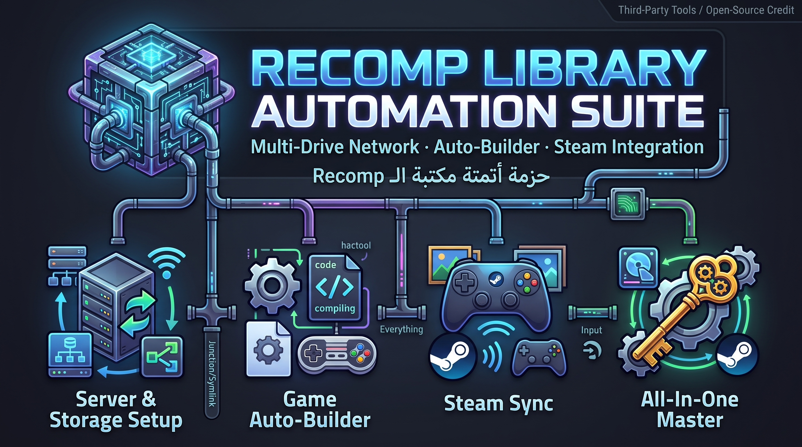

# حزمة أتمتة مكتبة الـ Recomp والمحاكيات والربط مع Steam (أدلة الوكيل الذكي)

🌐 **اللغة / Language:** **[English](./README.md)** | **العربية (Arabic)**

  

  

مجموعة متكاملة ومُجرَّبة عملياً من أدلة التشغيل الذكية (AI Agent Playbooks) وسكربتات الأتمتة لتنظيم وبناء وضبط ودمج **مشاريع إعادة الترجمة الثابتة للبي سي (Static Recompilation Ports - `RecompLauncher`)** و**مكتبات المحاكيات** عبر أقراص NVMe المحلية، والأقراص الإضافية، وسيرفرات التخزين المنزلية (SMB/NAS)، ومنصة **Steam**.

---

## ✨ المزايا والقدرات الأساسية

1. **إدارة المساحات، الترحيل الآمن للسيرفر، وتوحيد التخزينات (`01-recomp-server-storage`)**:
   - ربط دائم وسريع للسيرفر المنزلي عبر العنوان المحلي (`Local IP SMB 1Gbps+`) مع **حماية السيرفرات ذات الرام المحدود (`< 8GB RAM`)** عبر `robocopy /E /XO /MT:4` وجدولة نقل المجلدات ذات الملفات الكبيرة أولاً.
   - تفريغ مساحة قرص النظام `C:` دون كسر مسارات اللانشر باستخدام **وصلات النظام (`NTFS Junctions - mklink /J`)** للأقراص المحلية و**الروابط الرمزية (`Directory Symlinks - os.symlink`)** لمسارات الشبكة (لتجنب خطأ `WinError 2`)، مع إبقاء **كاش الشيدرز (`Shader Cache`)** محلياً على الـ NVMe لمنع تعليق التحميل عند 0%.
   - توحيد جميع ملفات الحفظ في مجلد محلي واحد (`<LOCAL_SAVES_DIR>`) ومزامنته تلقائياً بالخلفية كل ساعة وعند تسجيل الدخول إلى السيرفر عبر مهمة مجدولة صامتة (`robocopy /MIR`).

2. **الاكتشاف الذكي للرومات، البناء الآلي، وإصلاح بهتان ألوان الـ HDR (`02-recomp-auto-builder`)**:
   - البحث الفوري عن ملفات الألعاب والـ ROMs عبر فهرس **Everything (`es.exe` / `Everything.db`)** وإعدادات المحاكيات (`Dolphin.ini`, `PCSX2.ini`, `RPCS3 games.yml`, `Cemu`, `Xenia`) بالامتدادات ومعرّفات الألعاب (`Title IDs`) دون الاعتماد على أسماء المجلدات.
   - استخراج ودمج حزم `Base + Update + DLC` (`hactool`)، وتوليد `romfs.bin`، وتشغيل المترجمات (`gen` + `zig cc` / `clang`) توازيّاً عبر سطر الأوامر.
   - حلول جذرية للأعطال الشائعة: **إصلاح صوت Opus (`WT_OPUS_DLL`)**، **حل خطأ الذاكرة `error 1450` (`GOW3_STREAM_MEMORY=device` و `GOW3_DMEM_MB`)**، **إزالة أقفال الشيدر `.warming`**، و**إنهاء ظهور شاشات `First Run / Set Up / Insert Your Copy`** عبر مزامنة `recomplauncher.json` و `library.json` بعد إغلاق `recomplauncher.exe`.
   - تطبيق **معيار التوازن الذهبي** (`2560x1440`، `DLSS/FSR Quality`، `60 FPS`، إيقاف Motion Blur و Frame Gen، وتفعيل `~ HIGHDPIAWARE`)، مع **تنقية `SmartHdrManager` من ألعاب الـ SDR** لمنع بهتان الألوان وإبقاء الـ HDR للألعاب الداعمة لـ Native HDR10 فقط.

3. **الربط الشامل مع Steam والأغلفة وتفعيل Steam Input (`03-recomp-steam-sync`)**:
   - الاكتشاف التلقائي لحساب Steam النشط من `loginusers.vdf` (تحويل `SteamID64` إلى `AccountID` ثلاثي البت).
   - توحيد أسماء جميع الألعاب بصيغة **`<الاسم الحقيقي الكامل للعبة> (<اسم مشروع الريكومب>)`** داخل `shortcuts.vdf` مع الحفاظ على معرّف `appid` لكل لعبة.
   - جلب وتوليد صور الأغلفة الطولية (`<appid>p.png`)، والبانرات العريضة (`<appid>_hero.png`)، والصور الأفقية (`<appid>.png`)، والأيقونات (`<appid>_icon.png`) داخل مجلد `grid`.
   - إنشاء مجموعة **`Recomp Library`** في نظام المجموعات السحابي الحديث (`cloud-storage-namespace-1.json` و `cloud-storage-namespace-1.modified.json`)، وتفعيل **`Steam Input` (`UseSteamControllerConfig = 2`)** إجبارياً في `localconfig.vdf` لتعمل جميع أيدي التحكم (Xbox / DualSense / Switch Pro) فوراً.

4. **الأداة الشاملة الكاملة (`04-recomp-all-in-one`)**:
   - تدمج المراحل الثلاث بالترتيب الهندسي الصارم مع بروتوكول منع التعارض بين الوكلاء (`AGENTS_SYNC.json`) واختبار الإقلاع الفعلي لمدة 5 ثوانٍ لكل لعبة.

---

## 🛠️ الأدوات والاعتماديات المطلوبة (Prerequisites)

قبل تشغيل أي أداة عبر الوكيل الذكي، تأكد من توفر البرامج التالية على جهازك:

| الأداة / البرنامج | الوظيفة والدور الأساسي | الرابط الرسمي / طريقة التثبيت |
| :--- | :--- | :--- |
| **RecompLauncher** | اللانشر الأساسي لإدارة وتحديث وتشغيل بورتات الـ Recomp (`library.json`, `recomplauncher.json`, `pc-catalog.json`). | [recomplauncher.com](https://recomplauncher.com) |
| **Everything (`es.exe`)** | محرك الفهرسة الفوري للعثور على ملفات الألعاب والـ ROMs عبر الامتدادات ومعرّفات الألعاب دون التقيد بأسماء المجلدات. | [voidtools.com](https://www.voidtools.com/) (`winget install voidtools.Everything` + `voidtools.Everything.Cli`) |
| **SmartHdrManager** | أداة تفعيل Windows HDR تلقائياً؛ يضبطها الوكيل لتعمل حصراً مع ألعاب Native HDR10 ومنع بهتان ألعاب SDR. | [GitHub: SmartHdrManager](https://github.com/imniko/SmartHdrManager) |
| **hactool وأدوات المفاتيح** | لفك تشفير ودمج حزم `Base + Update + DLC` واستخراج `exefs` و `romfs` باستخدام `prod.keys`. | [GitHub: SciresM/hactool](https://github.com/SciresM/hactool) (مدمج أيضاً داخل حزم إعداد مشاريع الـ Recomp) |
| **Steam Client** | لتوحيد تعريفات يد التحكم (`Steam Input`)، وتشغيل الـ Overlay، وعرض المكتبة بالأغلفة الكاملة. | [store.steampowered.com](https://store.steampowered.com) |
| **Python 3.10+ & NTFS Links** | لتشغيل سكربتات الفحص، وبناء ملفات VDF الثنائية، وإنشاء وصلات `mklink /J` و `mklink /D`. | [python.org](https://www.python.org/) (`winget install Python.Python.3.12`) |

---

## 📂 هيكل المستودع والبطاقة البصرية للأدوات الأربع

  

| الأيقونة | الأداة | الدليل العربي (`.md`) | English Guide (`.md`) | متى تستخدمها؟ |
| :---: | :--- | :--- | :--- | :--- |
|  | **01. التخزين والسيرفر** | [`docs/ar/01-recomp-server-storage.md`](./docs/ar/01-recomp-server-storage.md) | [`docs/en/01-recomp-server-storage.md`](./docs/en/01-recomp-server-storage.md) | لتفريغ قرص `C:`، ونقل الرومات للسيرفر المنزلي بأمان (`< 8GB RAM`)، وتوحيد ومزامنة التخزينات. |
|  | **02. البناء الآلي والـ HDR** | [`docs/ar/02-recomp-auto-builder.md`](./docs/ar/02-recomp-auto-builder.md) | [`docs/en/02-recomp-auto-builder.md`](./docs/en/02-recomp-auto-builder.md) | للبحث عن الرومات عبر `Everything`، وبناء الألعاب المعلقة، وإلغاء شاشات `Set Up`، وإصلاح بهتان ألوان SDR. |
|  | **03. الربط مع Steam واليد** | [`docs/ar/03-recomp-steam-sync.md`](./docs/ar/03-recomp-steam-sync.md) | [`docs/en/03-recomp-steam-sync.md`](./docs/en/03-recomp-steam-sync.md) | لإضافة الألعاب إلى Steam بأسمائها الكاملة وصور أغلفتها ومجموعة `Recomp Library` وتفعيل `Steam Input`. |
|  | **04. الأداة الشاملة** | [`docs/ar/04-recomp-all-in-one.md`](./docs/ar/04-recomp-all-in-one.md) | [`docs/en/04-recomp-all-in-one.md`](./docs/en/04-recomp-all-in-one.md) | لتنفيذ جميع المراحل الثلاث بالترتيب من البداية للنهاية في جلسة واحدة منسقة. |

---

## 🚦 بوابة التحقق التفاعلي الإلزامية (Step 0)

تبدأ كل أداة في هذا المستودع ببوابة تحقق إلزامية (**Step 0**) قبل لمس أي ملف:
1. يفحص الوكيل مواصفات جهازك (**المعالج CPU**، **الرام RAM**، و**يفصل صراحةً بين كرت الشاشة المدمج iGPU والكرت المنفصل dGPU** مع عرض اسم الكرت المنفصل الفعلي).
2. يتوقف الوكيل **ويسألك مباشرة** لتأكيد المواصفات وتحديد مساراتك الخاصة (`<GAMES_ROMS_DIR>`، `<KEYS_DIR>`، `<SECONDARY_OR_NAS_DRIVE>`، `<RECOMP_LIB_DIR>`، والمجلدات المستثناة) قبل البدء بالتنفيذ.

---

## 🧠 المخطط الانسيابي والهيكلي الكامل للمنظومة (Mermaid Workflow)

```mermaid
flowchart TD
    A["🚦 بوابة التحقق (Step 0)<br/>فصل كرت الشاشة المدمج iGPU عن المنفصل dGPU + تأكيد المسارات"] --> B["01. هندسة التخزين والسيرفر<br/>ربط Local IP SMB + نقل آمن لرام أقل من 8GB عبر Robocopy /MT:4"]
    B --> C["وصلات NTFS Junctions للأقراص المحلية<br/>وروابط Directory Symlinks لمسارات الشبكة"]
    C --> D["إبقاء كاش الشيدرز على NVMe المحلي<br/>توحيد ملفات الحفظ + مزامنة مجدولة كل ساعة"]
    D --> E["02. الاكتشاف الفوري عبر Everything (es.exe)<br/>إيجاد الرومات والتحديثات والإضافات والمفاتيح بالامتدادات"]
    E --> F["الاستخراج والبناء الآلي<br/>hactool/nstool + gen + zig cc / llvm-mingw"]
    F --> G["الحلول الجذرية لأعطال التشغيل<br/>إصلاح صوت WT_OPUS_DLL + ذاكرة error 1450 + إزالة أقفال .warming"]
    G --> H["إنهاء شاشات First Run / Set Up نهائياً<br/>إغلاق اللانشر أولاً ثم مزامنة recomplauncher.json و library.json"]
    H --> I["ضبط التوازن الذهبي 1440p + تنقية SmartHdrManager<br/>إزالة ألعاب SDR لمنع بهتان الألوان وإبقاء Native HDR10 فقط"]
    I --> J["03. التكامل الشامل مع Steam وأيدي التحكم<br/>اكتشاف الحساب النشط تلقائياً من loginusers.vdf"]
    J --> K["إغلاق steam.exe ثم تحديث shortcuts.vdf<br/>بصيغة: الاسم الحقيقي الكامل للعبة (اسم مشروع الريكومب)"]
    K --> L["توليد الأغلفة الأربعة في grid + مجموعة Recomp Library<br/>تفعيل Steam Input الإجباري (UseSteamControllerConfig = 2)"]
    L --> M["✅ 04. الفحص النهائي واختبار الإقلاع الفعلي (5 ثوانٍ)<br/>مكتبة جاهزة 100% في RecompLauncher و Steam"]
```

---

## 🏗️ كيف تم بناء وتجميع هذه المنظومة (System Architecture & Engineering Breakdown)

1. **المرحلة الأولى — العزل الدقيق للعتاد وافتراضية التخزين الآمنة (`01-recomp-server-storage`)**:
   - تحتوي أغلب الأجهزة الحديثة على كرت شاشة مدمج (`iGPU`) وكرت منفصل (`dGPU`)؛ لذلك تبدأ كل أداة ببوابة **Step 0** التي تفحص العتاد وتفصل صراحةً بين الكرتين قبل اختيار إعدادات الريندر.
   - لتفريغ قرص النظام `C:` دون كسر المسارات الثابتة في `RecompLauncher`، صممنا المنظومة لتستخدم **وصلات `NTFS Junction` (`mklink /J`)** للأقراص المحلية، و**الروابط الرمزية (`os.symlink` / `mklink /D`)** لمسارات الشبكة والسيرفر لتجنب خطأ `WinError 2`، مع إبقاء مجلدات **كاش الشيدرز (`Shader Cache`)** محلياً على قرص الـ NVMe لمنع تعليق الألعاب عند `0%`.
   - لحماية السيرفرات المنزلية ذات الرام المحدود (`< 8GB RAM`) من الاختناق، يتم النقل عبر عنوان الـ IP المحلي المباشر باستخدام `robocopy /E /XO /MT:4` مع البدء بالمجلدات ذات الملفات الكبيرة الموحدة أولاً.
2. **المرحلة الثانية — الفهرسة الفورية، البناء التلقائي، وحماية دقة ألوان الـ SDR/HDR (`02-recomp-auto-builder`)**:
   - بدلاً من البحث اليدوي أو الاعتماد على أسماء المجلدات، يستعلم الوكيل مباشرة من محرك **Everything (`es.exe`)** وملفات إعدادات المحاكيات (`Dolphin`, `PCSX2`, `RPCS3`, `Cemu`, `Xenia`) بالامتدادات ومعرّفات الألعاب (`Title IDs`).
   - يقوم السكربت بفك ودمج `Base + Update + DLC` عبر `hactool` / `nstool`، وتوليد شيفرة الـ C وبنائها عبر `zig cc` / `llvm-mingw`، ثم يطبق الحلول الجذرية لأعطال الصوت (`WT_OPUS_DLL`) والذاكرة (`error 1450` عبر `GOW3_STREAM_MEMORY=device`)، ويلغي نوافذ `First Run / Set Up` عبر إغلاق `recomplauncher.exe` أولاً ثم توحيد `recomplauncher.json` و `library.json`.
   - يضبط الوكيل جميع الألعاب على **معيار التوازن الذهبي (`1440p` / `60 FPS` / `~ HIGHDPIAWARE`)** وينظف قائمة `SmartHdrManager` من ألعاب الـ SDR لمنع بهتان الألوان.
3. **المرحلة الثالثة — الهندسة الثنائية لملفات Steam VDF، الأغلفة، وتفعيل يد التحكم (`03-recomp-steam-sync`)**:
   - يحدد الوكيل الحساب النشط (`MostRecent = 1` في `loginusers.vdf`)، ويغلق `steam.exe` بالكامل، ثم يحدث `shortcuts.vdf` بالصيغة الموحدة `<الاسم الحقيقي الكامل للعبة> (<اسم مشروع الريكومب>)` مع الحفاظ على معرّف `appid` لكل لعبة.
   - يولّد الصور الأربع لكل لعبة داخل مجلد `grid` (`<appid>p.png`, `<appid>_hero.png`, `<appid>.png`, `<appid>_icon.png`)، وينشئ مجموعة **`Recomp Library`** في ملفات التخزين السحابي (`cloud-storage-namespace-1.json` و `.modified.json`)، ويفعّل **`Steam Input` (`UseSteamControllerConfig = 2`)** في `localconfig.vdf` لتعمل جميع أيدي التحكم فوراً.

---

## 📊 جدول مراحل التنفيذ الهندسي (Execution Pipeline Table)

| المرحلة | المدخلات الأساسية (Inputs) | الأداة المسؤولة (Tool) | العملية التقنية المنفذة (Technical Operation) | المخرج النهائي الموثّق (Output) |
| :--- | :--- | :--- | :--- | :--- |
| **Step 0: بوابة الفحص** | بيانات `WMI` و `nvidia-smi` ومسارات المستخدم | PowerShell + بوابة الحوار التفاعلي | فصل `iGPU` عن `dGPU`، قراءة الرام والـ VRAM، وأخذ تأكيد المستخدم على المسارات والمستثنيات | متغيرات بيئة مؤكدة وملف عتاد دقيق |
| **المرحلة 01: التخزين** | `<RECOMP_LIB_DIR>`, `<GAMES_ROMS_DIR>`, `<SAVES_DIR>` | `robocopy /MT:4`, `mklink /J`, `os.symlink`, `schtasks` | ترحيل المجلدات الضخمة، ربط المسارات شفافياً، إبقاء الشيدرز على NVMe، وجدولة مزامنة الحفظ كل ساعة | تفريغ قرص `C:`، صفر روابط مكسورة، وحفظ مؤمّن |
| **المرحلة 02: البناء والـ HDR** | فهرس `es.exe`، مفاتيح `prod.keys`، `pc-catalog.json` | `Everything`, `hactool`, `nstool`, `zig cc`, `SmartHdrManager` | استخراج الرومات، ترجمة الـ `.exe`، إصلاح `WT_OPUS_DLL` و `error 1450`، مزامنة `library.json`، وتنقية الـ HDR | ألعاب جاهزة (`Play`) بدقة `1440p` وألوان SDR/HDR صحيحة |
| **المرحلة 03: الربط مع Steam** | `library.json`, `loginusers.vdf`، صور المشاريع | محلل VDF الثنائي بـ Python، مكتبة `Pillow`، ملفات Cloud JSON | تسمية `<Real Title> (<Recomp>)`، توليد 4 صور `grid`، إنشاء مجموعة `Recomp Library`، وتفعيل `Steam Input` | مكتبة Steam متكاملة بالأغلفة واستجابة فورية لليد |
| **المرحلة 04: التدقيق الشامل** | جميع الألعاب المفعّلة (`verified: true`) | `04-recomp-all-in-one` + `AGENTS_SYNC.json` | اختبار إقلاع فعلي لمدة 5 ثوانٍ لكل لعبة، فحص سلامة الوصلات، وتثبيت الحالة النهائية | منظومة مدققة وشغالة بنسبة 100% |

---

## 🛠️ جدول استكشاف الأخطاء وحلولها الفورية (Comprehensive Troubleshooting Matrix)

| المشكلة / الخطأ الذي قد يواجهك | السبب الجذري التقني (Root Cause) | الحل الفوري الحاسم (Instant Deterministic Fix) |
| :--- | :--- | :--- |
| **خطأ `WinError 2` عند إنشاء وصلة لمجلد على السيرفر (`Z:\`)** | أمر `mklink /J` (`NTFS Junction`) يدعم الأقراص المحلية فقط ويرفض مسارات الشبكة `SMB/UNC`. | استخدم `mklink /J` للأقراص المحلية فقط، واستخدم `os.symlink` (`mklink /D`) لمسارات الشبكة والسيرفر. |
| **تعليق السيرفر المنزلي أو انقطاع اتصال SMB أثناء النقل** | استخدام خيوط عالية (`MT:32+`) أو نقل آلاف الملفات الصغيرة دفعة واحدة يستنزف ذاكرة الكاش والـ Non-paged Pool في السيرفرات ذات رام `< 8GB`. | اربط السيرفر عبر `Local IP` مباشر، واستخدم `robocopy /E /XO /MT:4`، وانقل مجلدات الملفات الكبيرة الموحدة أولاً. |
| **تعليق اللعبة عند `0%` أثناء بناء الشيدرز (Shader Compiling)** | نقل مجلد `shaders/` أو `cache/` إلى قرص بطيء أو مسار شبكة، أو وجود ملف قفل `.warming` من عملية سابقة مقاطعة. | أبقِ مجلدات الشيدرز محلياً على قرص NVMe، واحذف أي ملفات `*.warming` عالقة قبل التشغيل. |
| **ظهور خطأ الذاكرة `error 1450` (`Insufficient System Resources`)** | استنزاف الذاكرة الافتراضية المتصلة في ألعاب PS3/Xbox الثقيلة (مثل `God of War III`) عند محاولة حجز كامل البيانات في الرام. | عيّن متغيرات البيئة `GOW3_STREAM_MEMORY=device` و `GOW3_DMEM_MB=2048` (أو `4096`) وتأكد من تفعيل Pagefile على قرص NVMe. |
| **اختفاء الصوت في اللعبة أو صمت العروض السينمائية** | عدم عثور المحرك على مكتبة فك ترميز الصوت `opus.dll` (`libopus`) في مسار التشغيل (مثل `witch-time`). | مرّر المسار الكامل لملف `opus.dll` عبر المتغير `WT_OPUS_DLL` أو انسخ `opus.dll` بجانب الملف التنفيذي للعبة. |
| **استمرار ظهور نافذة `First Run / Set Up` أو `Insert Your Copy`** | تعديل `library.json` بينما `recomplauncher.exe` يعمل في الخلفية (مما يعيد كتابة الحالة القديمة عند إغلاقه) أو عدم ربط مسار `romfs`/`assets` في `recomplauncher.json`. | أغلق اللانشر فوراً (`taskkill /F /IM recomplauncher.exe`)، وتأكد من وجود `romfs.bin`/`assets`، وحدّث `recomplauncher.json` و `library.json` معاً (`verified: true` و `--play`). |
| **بهتان الألوان أو تحولها للرمادي الباهت عند تشغيل ألعاب الـ Recomp** | إدراج ألعاب SDR داخل قائمة `SmartHdrManager/config.json` مما يجبر ويندوز على تفعيل HDR لألعاب لا تدعمه. | أغلق `SmartHdrManager`، وأزل جميع ألعاب الـ SDR من `config.json` (أبقِ ألعاب Native HDR10 فقط)، وأطفئ Windows HDR أثناء تشغيل ألعاب الـ SDR. |
| **عدم ظهور مجموعة `Recomp Library` أو الأغلفة في Steam** | التعديل أثناء عمل `steam.exe`، أو التعديل في حساب غير نشط، أو الاكتفاء بملف `localconfig.vdf` دون تحديث ملفات التخزين السحابي الجديدة. | حدد الحساب النشط (`MostRecent = 1` في `loginusers.vdf`)، وأغلق `steam.exe` بالكامل، وحدّث `cloud-storage-namespace-1.json` و `.modified.json`، وضع الصور الأربع في `grid/`. |
| **عدم استجابة يد التحكم (Xbox / DualSense / Switch Pro) داخل اللعبة** | عدم تفعيل طبقة ترجمة المدخلات `Steam Input` للألعاب المضافة كـ Non-Steam Games. | اضبط `"UseSteamControllerConfig" "2"` لجميع معرّفات `appid` الخاصة بألعاب الـ Recomp داخل `localconfig.vdf` بعد إغلاق `steam.exe`. |

---

## 🤝 شكر وتقدير لمطوري الأدوات والبرامج المستخدمة (Third-Party Credits)

تعتمد هذه الحزمة وأدواتها الأربع على مجموعة من البرامج والأدوات الجانبية والمكتبات البرمجية — سواء كانت مستضافة على GitHub أو عبر مواقعها الرسمية المستقلة خارجه. نتقدم بالشكر والتقدير لجميع مطوريها وجهاتها الأصلية (راجع ملف [**CREDITS.md**](./CREDITS.md) للتفاصيل الكاملة):

- **File Indexing & Search Utilities (أدوات الفهرسة والبحث خارج GitHub):**
  - `Everything` & `Everything Command-line Interface (es.exe)` ([https://www.voidtools.com/](https://www.voidtools.com/)) *(by David Carpenter / voidtools — Freeware License)* — محرك الفهرسة الفوري والبحث السريع عن ملفات الألعاب والـ ROMs والـ BIOS دون التقيد بأسماء المجلدات.
- **Display & HDR Management Utilities (أدوات الشاشة والـ HDR):**
  - `SmartHdrManager` ([https://github.com/imniko/SmartHdrManager](https://github.com/imniko/SmartHdrManager)) *(by Developer / Maintainer `imniko` — MIT License)* — أداة إدارة تفعيل Windows HDR تلقائياً للألعاب الداعمة وفصل ألعاب SDR لمنع بهتان الألوان.
- **Recompilation & Launcher Ecosystem (منظومة البورتات واللانشر):**
  - `RecompLauncher` ([https://recomplauncher.com](https://recomplauncher.com)) *(by Zexyen / RecompLauncher Team — Freeware / Proprietary Launcher)* — واجهة إدارة مكتبة البورتات والكتالوج (`library.json` و `recomplauncher.json`).
  - مشاريع الـ Recomp مفتوحة المصدر الأساسية: [`N64Recomp`](https://github.com/N64Recomp/N64Recomp) *(by Mr-Wiseguy — MIT License)*، [`XenonRecomp`](https://github.com/hedge-dev/XenonRecomp) / [`UnleashedRecomp`](https://github.com/hedge-dev/UnleashedRecomp) *(by hedge-dev — MIT / GPL-3.0)*، ومطورو مجتمع بورتات Switch / PS2 / PS3 / GameCube *(GPL-2.0 / GPL-3.0 / MIT)*.
- **Console Extraction, Decryption & Firmware Tools (أدوات فك التشفير والاستخراج):**
  - `hactool` ([https://github.com/SciresM/hactool](https://github.com/SciresM/hactool)) *(by SciresM — ISC License)* — أداة سطر الأوامر لفك وتجميع حزم Nintendo Switch (`Base + Update + DLC`).
  - `nstool` ([https://github.com/jakcron/nstool](https://github.com/jakcron/nstool)) *(by jakcron — MIT License)* — أداة فحص واستخراج محتويات ملفات Nintendo Switch.
- **Storefront, Controller & Platform Integration (التكامل مع المتاجر وأيدي التحكم):**
  - `Valve Steam Client & Steam Input / VDF Format` ([https://store.steampowered.com/](https://store.steampowered.com/)) *(by Valve Corporation — Proprietary / Free Client)* — التكامل مع المكتبة (`shortcuts.vdf`, `localconfig.vdf`, `cloud-storage-namespace-1.json`, `grid`) وتوحيد عمل أيدي التحكم.
- **Runtime, Audio, Graphics & Python Libraries (المكتبات البرمجية والصوتية والرسومية):**
  - `Python 3` ([https://www.python.org/](https://www.python.org/)) *(by Python Software Foundation — PSF License)* — بيئة تشغيل سكربتات الأتمتة والتدقيق.
  - `Pillow (PIL Fork)` ([https://python-pillow.org/](https://python-pillow.org/)) *(by Jeffrey A. Clark / Alex Clark & Contributors — HPND / MIT-CMU License)* — معالجة وتحويل صور الأغلفة والبنرات في Steam `grid`.
  - `libopus` ([https://opus-codec.org/](https://opus-codec.org/)) *(by Xiph.Org Foundation — BSD-3-Clause License)* — مكتبة فك ترميز الصوت المستخدمة في إصلاح صوتيات الألعاب (مثل `WT_OPUS_DLL`).
  - `SDL2` ([https://www.libsdl.org/](https://www.libsdl.org/)) *(by Sam Lantinga & SDL Contributors — zlib License)* — طبقة النوافذ والمدخلات.
  - `Microsoft Windows Native Utilities (mklink / Robocopy / PowerShell / Registry)` ([https://learn.microsoft.com/en-us/windows-server/administration/windows-commands/](https://learn.microsoft.com/en-us/windows-server/administration/windows-commands/)) *(by Microsoft Corporation — Windows OS Built-in Tools)* — لإنشاء وصلات `NTFS Junction` و `Directory Symlinks` ومزامنة ملفات الحفظ وتطبيق توافق `~ HIGHDPIAWARE`.

---

## ⚖️ الترخيص وشروط الاستخدام (License & Usage Terms)

**جميع الحقوق محفوظة © 2026 للمطور `axxx503`.**

1. **الاستخدام الشخصي والمجتمعي (مسموح ومجاني):** يُسمح لأي مستخدم فردي أو مطور باستخدام هذه الملفات والأدوات وتعديلها وتطويرها لأغراض شخصية أو تعليمية أو مجتمعية غير ربحية مجاناً، مع الإبقاء على إشعار حقوق النشر الأصلي وذكر المصدر (**`axxx503`**).
2. **الاستخدام التجاري (ممنوع منعاً باتاً إلا بإذن وتنسيق شخصي):** يُمنع منعاً باتاً استخدام هذا المشروع أو أي جزء منه أو أي نسخ مشتقة أو مطوّرة منه لأي غرض تجاري أو ربحي (بما في ذلك الشركات، المتاجر، الخدمات المدفوعة، التوزيع التجاري المدمج، أو تقديمه كخدمة مدفوعة للعملاء) إلا بعد **التواصل المباشر مع صاحب المشروع (`axxx503`) والحصول على ترخيص تجاري مكتوب**.
3. **حقوق الملكية الفكرية والتطوير المستقبلي:** يحتفظ المؤلف الأصلي (**`axxx503`**) بكامل حقوق الملكية الفكرية للمشروع وجميع إصداراته وتطويراته المستقبلية، بينما تخضع جميع البرامج والأدوات الخارجية المذكورة في قسم [Third-Party Credits](./CREDITS.md) لتراخيص مطوريها وجهاتها الأصلية.

للاطلاع على النص الكامل للترخيص باللغتين، راجع ملف [LICENSE.md](./LICENSE.md).

---

## 🌐 للتواصل والدعم
- **حسابات التواصل (Instagram / TikTok):** [https://bio.site/V7dt1](https://bio.site/V7dt1)
- **البريد الإلكتروني (للاستفسارات والترخيص التجاري):** v7dtads@gmail.com
- **دعم المشروع (Buy Me a Coffee):** [https://buymeacoffee.com/axxx503](https://buymeacoffee.com/axxx503)

---

## 🐍 سكربتات الأتمتة المرفقة (`scripts/`)

جميع السكربتات التالية تعمل بمكتبات **Python 3.11+ القياسية فقط** (دون اعتماديات خارجية) وتدعم وضع `--dry-run` قبل `--execute`. انسخ [`config.example.json`](./config.example.json) واستبدل القيم الافتراضية (`<SERVER_IP>`, `<SHARE_NAME>`, `<USER>`, `<STEAM_ACCOUNT_ID>`) قبل التشغيل:

| السكربت | البيئة المستهدفة | الوظيفة |
| :--- | :--- | :--- |
| [`scripts/server_organizer.py`](./scripts/server_organizer.py) | السيرفر (`/media/storage`) | تنظيم السيرفر بسياسة **صفر حذف** إلى هيكل 4 مجلدات لكل منصة (`keys/`, `texture/`, `saves/`, `games/`)، وتوحيد `NVIDIA_GeForce/`، وأرشفة التكرارات (`>= 5 MB`) في `Duplicates_Archive/` مع `.root_source.txt`. |
| [`scripts/pc_to_server_migrator.py`](./scripts/pc_to_server_migrator.py) | الويندوز -> `Z:\` | ترحيل المنصات المتجهة للسيرفر والتحقق بـ `SHA-256` بنسبة 100% قبل حذف النسخ المحلية (مع استثناء ألعاب الـ PC و `PS4` و `PS5` و `Switch 2` بالكامل). |
| [`scripts/nvidia_15day_archiver.py`](./scripts/nvidia_15day_archiver.py) | الويندوز -> `Z:\NVIDIA_GeForce` | أرشفة لقطات NVIDIA الأقدم من 15 يوماً مع فحص قفل الملف والتحقق بـ `SHA-256`. |
| [`scripts/relink_phase4.py`](./scripts/relink_phase4.py) | الويندوز | إعادة ربط وصلات `C:\Recomp Library` وتحديث مسارات `yuzu` و `eden` و `PCSX2` و `Cemu` و `Dolphin` و `RetroArch` نحو `Z:\`. |
| [`scripts/fix_steam_vdf.py`](./scripts/fix_steam_vdf.py) | Steam (`shortcuts.vdf`) | محلل VDF ثنائي آمن يحدّث مسارات `Exe`/`StartDir` المنتقلة مع الحفاظ التام على `appid` و `AppName` و `tags`. |
| [`scripts/restore_recomp_collection.py`](./scripts/restore_recomp_collection.py) | Steam (`cloudstorage`) | استعادة مجموعة `Recomp Library` في القائمة الجانبية لـ Steam داخل `cloud-storage-namespace-1.json` و `.modified.json`. |
