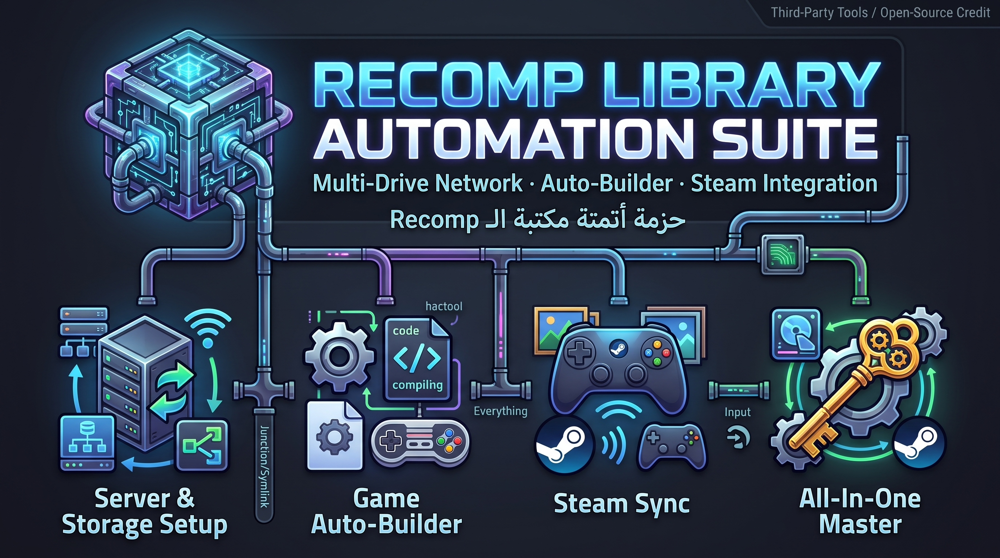

# Recomp & Emulator Library Automation Suite (AI Agent Playbooks)

🌐 **Language / اللغة:** **English** | **[العربية (Arabic)](./README.ar.md)**

  

  

A production-tested, bilingual collection of AI Agent Playbooks and automation workflows for organizing, building, optimizing, and integrating **Static Recompilation PC Ports** (`RecompLauncher`) and **Console Emulator Libraries** across local NVMe drives, secondary storage, SMB/NAS home servers, and **Steam**.

---

## ✨ Key Capabilities

1. **Smart Storage, NAS Migration & Unified Cloud Saves (`01-recomp-server-storage`)**:
   - Persistent high-speed local-IP SMB mapping (`1Gbps+`) with **Low-RAM NAS Protection (`< 8GB RAM`)** using throttled `robocopy /E /XO /MT:4` and large-file-first scheduling.
   - Zero-footprint local drive relief using **NTFS Junctions (`mklink /J`)** for local disks and **Directory Symbolic Links (`os.symlink`)** for network shares (preventing `WinError 2` loader failures), while keeping latency-sensitive **Shader Caches** on local NVMe.
   - Unified local save hub (`<LOCAL_SAVES_DIR>`) linked across all emulators and Recomp ports, backed by a silent hourly/logon `robocopy /MIR` scheduled task to `<SECONDARY_OR_NAS_DRIVE>`.

2. **Automated ROM Discovery, Headless Recomp Builder & Color-Accurate HDR (`02-recomp-auto-builder`)**:
   - Instant, folder-name-agnostic ROM/ISO/XCI/NSP discovery via **Everything (`es.exe` / `Everything.db`)** and emulator configs (`Dolphin.ini`, `PCSX2.ini`, `RPCS3 games.yml`, `Cemu settings.xml`, `Xenia`).
   - Automated `Base + Update + DLC` SuperXCI extraction (`hactool`), `romfs.bin` packing, and parallel `gen` + `zig cc` / `clang` headless compilation.
   - Built-in fixes for common port issues: **Opus audio (`WT_OPUS_DLL`)**, **Windows commit-limit `error 1450` (`GOW3_STREAM_MEMORY=device` & `GOW3_DMEM_MB`)**, **0% shader cache `.warming` locks**, and **eliminating `First Run / Set Up / Insert Your Copy` screens** by syncing `recomplauncher.json` and `library.json` while `recomplauncher.exe` is closed.
   - **Golden Balance Preset** (`2560x1440`, `DLSS/FSR Quality`, `60 FPS`, Motion Blur & Frame Gen Off, `~ HIGHDPIAWARE`) and **SDR Color Fix** (purging SDR games from `SmartHdrManager` so Windows HDR only activates for true Native HDR10 ports).

3. **Full Steam Library, Grid Artwork & Steam Input Integration (`03-recomp-steam-sync`)**:
   - Automatic detection of the active Steam user from `loginusers.vdf` (`SteamID64` to 32-bit `AccountID`).
   - Standardized naming **`<Real Game Title> (<Recomp Project Name>)`** in binary `shortcuts.vdf` without breaking existing `appid` bindings.
   - Parallel artwork provisioning (`<appid>p.png` vertical cover, `<appid>_hero.png` banner, `<appid>.png` wide capsule, `<appid>_icon.png`) into `userdata/<ACTIVE_ACCOUNT_ID>/config/grid/`.
   - Native Steam Cloud collection creation (`Recomp Library` in both `cloud-storage-namespace-1.json` and `cloud-storage-namespace-1.modified.json`) and forced **Steam Input (`UseSteamControllerConfig = 2`)** in `localconfig.vdf` for Xbox, DualSense, and Switch Pro controllers.

4. **All-in-One Master Pipeline (`04-recomp-all-in-one`)**:
   - Combines all three stages in strict dependency order with multi-agent lock coordination (`AGENTS_SYNC.json`) and 5-second live process boot verification.

---

## 🛠️ Prerequisites & Required Tools

Before running any playbook with your AI coding agent, ensure the following tools are available on your Windows PC:

| Tool / Dependency | Role & Purpose | Official Link / Installation |
| :--- | :--- | :--- |
| **RecompLauncher** | Central manager for static recompilation PC ports (`library.json`, `recomplauncher.json`, `pc-catalog.json`). | [recomplauncher.com](https://recomplauncher.com) |
| **Everything (`es.exe`)** | Instant NTFS/ReFS filename & extension indexer used to locate ROMs, ISOs, XCIs, and XEXs regardless of folder names. | [voidtools.com](https://www.voidtools.com/) (`winget install voidtools.Everything` + `voidtools.Everything.Cli`) |
| **SmartHdrManager** | Auto-toggles Windows HDR per executable; curated by our playbooks so only true Native HDR10 games trigger HDR. | [GitHub: SmartHdrManager](https://github.com/imniko/SmartHdrManager) |
| **hactool & Key Tools** | Decrypts and unpacks Switch `Base + Update + DLC` NCAs (`--basenca`, `--exefsdir`, `--romfsdir`) using `prod.keys`. | [GitHub: SciresM/hactool](https://github.com/SciresM/hactool) (also bundled inside major Recomp setups) |
| **Steam Client** | Provides unified **Steam Input** controller remapping, in-game overlay, and library grid view. | [store.steampowered.com](https://store.steampowered.com) |
| **Python 3.10+ & NTFS Links** | Runs the automation, binary VDF parser, parallel compiler wrappers, and Windows Junctions (`mklink /J`) / Symlinks (`mklink /D`). | [python.org](https://www.python.org/) (`winget install Python.Python.3.12`) |

---

## 📂 Repository Structure & Playbook Guide

| Playbook | English Guide | الدليل العربي (Arabic) | When to Use |
| :--- | :--- | :--- | :--- |
| **01. Storage & NAS** | [`docs/en/01-recomp-server-storage.md`](./docs/en/01-recomp-server-storage.md) | [`docs/ar/01-recomp-server-storage.md`](./docs/ar/01-recomp-server-storage.md) | When freeing space on `C:`, offloading ROMs/built data to a secondary drive or NAS (`< 8GB RAM` safe), and unifying saves. |
| **02. Auto-Builder & HDR** | [`docs/en/02-recomp-auto-builder.md`](./docs/en/02-recomp-auto-builder.md) | [`docs/ar/02-recomp-auto-builder.md`](./docs/ar/02-recomp-auto-builder.md) | When discovering ROMs via `Everything`, building pending Recomp ports, fixing `Set Up` loops, and fixing washed-out SDR colors. |
| **03. Steam & Controller Sync** | [`docs/en/03-recomp-steam-sync.md`](./docs/en/03-recomp-steam-sync.md) | [`docs/ar/03-recomp-steam-sync.md`](./docs/ar/03-recomp-steam-sync.md) | When exporting verified Recomp ports to Steam with `<Game> (<Recomp>)` names, box art covers, collections, and forced Steam Input. |
| **04. All-in-One Suite** | [`docs/en/04-recomp-all-in-one.md`](./docs/en/04-recomp-all-in-one.md) | [`docs/ar/04-recomp-all-in-one.md`](./docs/ar/04-recomp-all-in-one.md) | When running the complete end-to-end pipeline from scratch in one coordinated session. |

---

## 🚦 Mandatory Step 0: Hardware & Path Verification Gate

Every playbook in this repository enforces a **strict non-destructive Step 0 Gate**:
1. The agent first inspects your **CPU**, **RAM**, and **GPU**—explicitly distinguishing between your **Integrated GPU (iGPU)** and **Discrete GPU (dGPU)** so render/VRAM budgets are tuned for your real dedicated graphics card.
2. The agent **stops and asks for your confirmation** along with your custom paths (`<GAMES_ROMS_DIR>`, `<KEYS_DIR>`, `<SECONDARY_OR_NAS_DRIVE>`, `<RECOMP_LIB_DIR>`, and excluded folders) before modifying any file.

---

## 🧠 End-to-End Architecture & Workflow Diagram (Mermaid)

```mermaid
flowchart TD
    A["🚦 Step 0: Hardware & Path Gate<br/>Separate iGPU vs dGPU + Confirm User Paths"] --> B["01. Storage & Server Architecture<br/>Local IP SMB + Low-RAM Robocopy /MT:4"]
    B --> C["NTFS Junctions (mklink /J) for Local Drives<br/>Directory Symlinks (os.symlink) for Network"]
    C --> D["Keep Shader Cache on Local NVMe<br/>Unified Saves + Hourly schtasks Sync"]
    D --> E["02. Everything Index Discovery (es.exe)<br/>Locate ROMs, Title IDs, Updates, DLC & Keys"]
    E --> F["Automated Extraction & Compilation<br/>hactool/nstool + gen + zig cc / llvm-mingw"]
    F --> G["Root-Cause Runtime Fixes<br/>WT_OPUS_DLL + GOW3_DMEM_MB + Clear .warming"]
    G --> H["Bypass First-Run / Set Up Screens<br/>Close Launcher -> Sync recomplauncher.json & library.json"]
    H --> I["Golden 1440p Profile + SmartHdrManager Cleanup<br/>Strip SDR Games / Keep Native HDR10 Only"]
    I --> J["03. Steam & Controller Integration<br/>Detect Active AccountID from loginusers.vdf"]
    J --> K["Close steam.exe -> Update shortcuts.vdf<br/>Format: Real Game Title (Recomp Project Name)"]
    K --> L["Generate 4x Grid Assets + Cloud Collection<br/>Force Steam Input (UseSteamControllerConfig = 2)"]
    L --> M["✅ 04. Final 5-Second Live Boot Verification<br/>100% Playable Library in RecompLauncher & Steam"]
```

---

## 🏗️ System Architecture & Engineering Breakdown (How This Suite Was Built)

1. **Phase 1 — Hardware Isolation & Non-Destructive Storage Virtualization (`01`)**:
   - Many multi-GPU laptops and desktops expose both an integrated GPU (`iGPU`) and a discrete GPU (`dGPU`). Every playbook begins with a mandatory **Step 0 Hardware Gate** that queries `Win32_VideoController` and `nvidia-smi` to explicitly separate `iGPU` from `dGPU` before choosing rendering profiles.
   - To free primary `C:` NVMe space without breaking hardcoded paths in `RecompLauncher`, the suite uses **NTFS Junctions (`mklink /J`)** for local secondary drives and **Directory Symlinks (`os.symlink`)** for SMB network shares (avoiding `WinError 2`), while strictly keeping `shaders/` / `cache/` on local NVMe storage so games never freeze at `0%` shader compilation.
   - For home servers with limited memory (`< 8GB RAM`), transfers are throttled via `robocopy /E /XO /MT:4` starting with large-file directories first to prevent SMB non-paged pool exhaustion.
2. **Phase 2 — Instant ROM Indexing, Automated Recompilation & SDR/HDR Color Integrity (`02`)**:
   - Instead of relying on folder names, the agent queries **Everything (`es.exe`)** and emulator configurations (`Dolphin.ini`, `PCSX2.ini`, `RPCS3 games.yml`, `Cemu`, `Xenia`) by file extension and Console Title ID.
   - It automates `Base + Update + DLC` decryption (`hactool` / `nstool`), C code generation (`gen`), and multi-threaded compilation (`zig cc` / `llvm-mingw`), then applies deterministic fixes for silent audio (`WT_OPUS_DLL`), VRAM/pagefile exhaustion (`error 1450` via `GOW3_STREAM_MEMORY=device`), and stuck `First Run / Set Up` prompts (by closing `recomplauncher.exe` before synchronizing `recomplauncher.json` and `library.json`).
   - Finally, it applies the **Golden 1440p Profile** (`2560x1440`, `DLSS/FSR Quality`, `60 FPS`, `~ HIGHDPIAWARE`) and purges SDR executables from `SmartHdrManager` so Windows HDR activates strictly for true Native HDR10 titles.
3. **Phase 3 — Binary Steam VDF Engineering, Artwork Pipeline & Universal Gamepad Fix (`03`)**:
   - The agent resolves the active Steam user (`MostRecent = 1` in `loginusers.vdf`), gracefully closes `steam.exe`, and updates `shortcuts.vdf` with the canonical naming format `<Real Game Title> (<Recomp Project Name>)` while preserving existing unsigned 32-bit `appid` hashes.
   - It populates all 4 Steam artwork slots in `userdata/<active_id>/config/grid/` (`<appid>p.png`, `<appid>_hero.png`, `<appid>.png`, `<appid>_icon.png`), registers the **`Recomp Library`** collection directly inside Steam's modern Cloud Storage files (`cloud-storage-namespace-1.json` and `.modified.json`), and sets `UseSteamControllerConfig = "2"` inside `localconfig.vdf` so Xbox, DualSense, and Switch Pro controllers work immediately.

---

## 📊 Execution Pipeline Table

| Stage | Primary Inputs | Responsible Tool / Component | Technical Operation Executed | Verified Final Output |
| :--- | :--- | :--- | :--- | :--- |
| **Step 0: Gate** | WMI / `nvidia-smi` / User Paths | PowerShell + Agent Interactive Prompt | Separates `iGPU` vs `dGPU`, measures RAM/VRAM, and asks user to confirm all paths & exclusions | Confirmed environment variables & hardware profile |
| **Stage 01: Storage** | `<RECOMP_LIB_DIR>`, `<GAMES_ROMS_DIR>`, `<SAVES_DIR>` | `robocopy /MT:4`, `mklink /J`, `os.symlink`, `schtasks` | Migrates heavy payloads, links folders back transparently, keeps shaders on NVMe, schedules hourly save sync | Freed `C:` space, `0` broken links, backed-up saves |
| **Stage 02: Builder** | `es.exe` Index, `prod.keys`, `pc-catalog.json` | `Everything`, `hactool`, `nstool`, `zig cc`, `SmartHdrManager` | Extracts ROMs, compiles `.exe`, patches `WT_OPUS_DLL` & `error 1450`, syncs `library.json`, cleans SDR from HDR manager | `verified: true` Playable games at `1440p` with accurate SDR/HDR colors |
| **Stage 03: Steam** | `library.json`, `loginusers.vdf`, Cover Assets | Python Binary VDF Parser, `Pillow (PIL)`, Steam Cloud JSON | Formats `AppName` as `<Real Title> (<Recomp>)`, builds 4x `grid` PNGs, creates `Recomp Library` collection, enables Steam Input | Full-artwork Steam library with working controllers |
| **Stage 04: QA Audit** | All `verified: true` Executables | `04-recomp-all-in-one` + `AGENTS_SYNC.json` | Launches each game for 5 seconds, verifies window stability, checks `0` broken junctions, and locks state | 100% audited end-to-end setup |

---

## 🛠️ Comprehensive Troubleshooting Matrix (Root Causes & Instant Fixes)

| Symptom / Error Encountered | Root Technical Cause | Instant Deterministic Fix |
| :--- | :--- | :--- |
| **`WinError 2` / `Cannot create a file when that file already exists` on Network Share** | Windows `mklink /J` (NTFS Junction) only supports local volume GUIDs and rejects remote UNC/SMB network paths (`Z:\` or `\IP\Share`). | Use `mklink /J` strictly for local drives (`C:`, `D:`, `F:`, `H:`) and use Python `os.symlink(src, dst, target_is_directory=True)` (`mklink /D`) for network paths. |
| **Home Server / NAS Freezes or Drops SMB Connection During Transfer** | High-thread `robocopy /MT:32+` or transferring millions of tiny files floods the SMB cache and exhausts non-paged kernel memory on `< 8GB RAM` servers. | Connect via direct Local IP (`\192.168.x.x\Share`), cap threads to `robocopy /E /XO /MT:4`, and transfer large single-file ISO/NSP/PKG folders before small extracted files. |
| **Game Hangs Indefinitely at `0%` Compiling Shaders on Launch** | Shader cache directory (`shaders/` or `cache/`) was moved to a slow HDD or network share, or an interrupted build left a `.warming` lock file. | Keep shader cache directories on local NVMe storage and delete stale `*.warming` lock files before relaunching. |
| **`error 1450` (`Insufficient System Resources Exist to Complete the Requested Service`)** | Heavy PS3/Xbox recomp ports (e.g., God of War III) exhaust contiguous Win32 virtual memory mapping when streaming everything into host RAM. | Set environment variables `GOW3_STREAM_MEMORY=device` and `GOW3_DMEM_MB=2048` (or `4096`), and ensure Windows Pagefile is system-managed on NVMe. |
| **Game Launches with Silent Audio or Missing Cutscene Voice Tracks** | Recomp runtime cannot locate `opus.dll` (`libopus`) in the default working directory (`witch-time` / Bayonetta / Switch ports). | Point the `WT_OPUS_DLL` environment variable (or copy `opus.dll`) directly to the verified `opus.dll` path inside the game's runtime folder. |
| **Game Still Opens on `First Run / Set Up` or `Insert Your Copy` Screen** | `recomplauncher.exe` was still running in the background when `library.json` was edited, causing its in-memory state to overwrite the file on exit, or `romfs.bin` / `assets` path was not written to `recomplauncher.json`. | Run `taskkill /F /IM recomplauncher.exe` **first**, verify extracted `romfs` / `assets` exist, update both `recomplauncher.json` and `library.json` (`verified: true`, `--play`), then relaunch. |
| **Washed-Out, Gray, or Over-Bright Colors When Launching SDR Games** | `SmartHdrManager` has SDR recomp executables registered in its `config.json`, forcing Windows 11 HDR ON for games that output standard SDR. | Close `SmartHdrManager`, remove all SDR recomp `.exe` entries from `SmartHdrManager/config.json` (retaining only true Native HDR10 titles), and turn Windows HDR off for SDR play. |
| **Steam Collection `Recomp Library` or Custom Covers Do Not Appear** | Modifications were written while `steam.exe` was running, written to an inactive `userdata/<id>` folder, or written only to legacy `localconfig.vdf` instead of `cloud-storage-namespace-1.json`. | Check `MostRecent = 1` in `loginusers.vdf`, close `steam.exe` completely, write collection JSON to both `cloud-storage-namespace-1.json` and `.modified.json`, and place all 4 PNG types in `userdata/<active_id>/config/grid/`. |
| **Controller (Xbox / DualSense / Switch Pro) Does Not Respond Inside Game** | SDL2/XInput hooks in raw recomp executables fail to bind the controller without Steam's virtual gamepad translation layer. | Set `"UseSteamControllerConfig" "2"` for all recomp unsigned `appid` entries inside `userdata/<active_id>/config/localconfig.vdf` while `steam.exe` is closed. |

---

## 🤝 Third-Party Credits & Acknowledgments

This suite integrates with and relies upon external tools, freeware applications, command-line utilities, and open-source libraries hosted both **on GitHub and on independent official websites**. Full details are documented in [**CREDITS.md**](./CREDITS.md):

- **File Indexing & Search Utilities (Outside GitHub)**:
  - **Everything & Everything Command-line Interface (`es.exe`)** ([https://www.voidtools.com/](https://www.voidtools.com/)) *(by David Carpenter / voidtools — Freeware License)* — Instant NTFS indexing and rapid search for game ROMs, updates, DLCs, and BIOS/keys without relying on folder names.
- **Display & HDR Management Utilities**:
  - **SmartHdrManager** ([https://github.com/imniko/SmartHdrManager](https://github.com/imniko/SmartHdrManager)) *(by Developer / Maintainer `imniko` — MIT License)* — Automatic Windows HDR switching for supported Native HDR10 titles and separating SDR games to prevent washed-out colors.
- **Recompilation & Launcher Ecosystem**:
  - **RecompLauncher** ([https://recomplauncher.com](https://recomplauncher.com)) *(by Zexyen / RecompLauncher Team — Freeware / Proprietary Launcher)* — Library and catalog management interface (`library.json` & `recomplauncher.json`).
  - **Core Open-Source Recomp Projects**: **N64Recomp** ([https://github.com/N64Recomp/N64Recomp](https://github.com/N64Recomp/N64Recomp)) *(by Mr-Wiseguy — MIT License)*, **XenonRecomp** / **UnleashedRecomp** ([https://github.com/hedge-dev/XenonRecomp](https://github.com/hedge-dev/XenonRecomp)) *(by hedge-dev — MIT / GPL-3.0)*, and community developers of Switch / PS2 / PS3 / GameCube / Wii U / PS1 recompilation ports *(GPL-2.0 / GPL-3.0 / MIT)*.
- **Console Extraction, Decryption & Firmware Tools**:
  - **hactool** ([https://github.com/SciresM/hactool](https://github.com/SciresM/hactool)) *(by SciresM — ISC License)* — Command-line tool for decrypting and merging Nintendo Switch packages (`Base + Update + DLC`).
  - **nstool** ([https://github.com/jakcron/nstool](https://github.com/jakcron/nstool)) *(by jakcron — MIT License)* — Utility for inspecting and extracting Nintendo Switch file contents.
- **Storefront, Controller & Platform Integration**:
  - **Valve Steam Client & Steam Input / VDF Format** ([https://store.steampowered.com/](https://store.steampowered.com/)) *(by Valve Corporation — Proprietary / Free Client)* — Library integration (`shortcuts.vdf`, `localconfig.vdf`, `cloud-storage-namespace-1.json`, `grid`) and unified controller support via `Steam Input`.
- **Runtime, Audio, Graphics & Python Libraries**:
  - **Python 3** ([https://www.python.org/](https://www.python.org/)) *(by Python Software Foundation — PSF License)* — Runtime environment for automation and auditing scripts.
  - **Pillow (PIL Fork)** ([https://python-pillow.org/](https://python-pillow.org/)) *(by Jeffrey A. Clark / Alex Clark & Contributors — HPND / MIT-CMU License)* — Processing and converting cover and banner artwork in Steam `grid`.
  - **libopus** ([https://opus-codec.org/](https://opus-codec.org/)) *(by Xiph.Org Foundation — BSD-3-Clause License)* — Audio decoding library used to fix game audio playback (such as `WT_OPUS_DLL`).
  - **SDL2** ([https://www.libsdl.org/](https://www.libsdl.org/)) *(by Sam Lantinga & SDL Contributors — zlib License)* — Windowing and input abstraction layer.
  - **Microsoft Windows Native Utilities (`mklink` / `Robocopy` / `PowerShell` / `Registry`)** ([https://learn.microsoft.com/en-us/windows-server/administration/windows-commands/](https://learn.microsoft.com/en-us/windows-server/administration/windows-commands/)) *(by Microsoft Corporation — Windows OS Built-in Tools)* — Creating `NTFS Junction` and `Directory Symlinks`, synchronizing save files, and applying `~ HIGHDPIAWARE` compatibility.

---

## ⚖️ License & Usage Terms (Non-Commercial)

**Copyright © 2026 axxx503. All Rights Reserved.**

1. **Personal & Community Use (Permitted & Free):** Any individual user or developer is permitted to use, modify, and improve these files, scripts, and tools free of charge for personal, educational, or non-profit community purposes, provided that the original copyright notice and clear attribution to the source (**`axxx503`**) are retained.
2. **Commercial Use (Strictly Prohibited Without Personal Coordination & Written Permission):** It is strictly prohibited to use this project, any part of it, or any derivative or modified versions of it for any commercial or for-profit purpose (including companies, stores, paid services, commercial bundling/distribution, or offering it as a paid service to clients) without **direct contact with the project owner (`axxx503`) and obtaining a written commercial license**.
3. **Intellectual Property Rights & Future Development:** The original author (**`axxx503`**) retains full intellectual property rights to the project and all of its future releases and developments, while all external programs, tools, and libraries listed in the [Third-Party Credits](./CREDITS.md) section remain governed by the licenses of their respective original developers and organizations.

See the full bilingual license in [LICENSE.md](./LICENSE.md).

---

## 🌐 Contact & Support
- **Social Media (Instagram / TikTok):** [https://bio.site/V7dt1](https://bio.site/V7dt1)
- **Email (Inquiries & Commercial Licensing):** v7dtads@gmail.com
- **Support the Project (Buy Me a Coffee):** [https://buymeacoffee.com/axxx503](https://buymeacoffee.com/axxx503)

---

## 🐍 Included Python Automation Scripts (`scripts/`)

All scripts below use **zero external dependencies** (Python 3.11+ standard library only) and support `--dry-run` by default before `--execute`. Copy [`config.example.json`](./config.example.json) and replace placeholders (`<SERVER_IP>`, `<SHARE_NAME>`, `<USER>`, `<STEAM_ACCOUNT_ID>`) before running:

| Script | Target | Purpose |
| :--- | :--- | :--- |
| [`scripts/server_organizer.py`](./scripts/server_organizer.py) | Debian/CasaOS (`/media/storage`) | Zero-deletion server organizer: builds standardized 4-folder console layouts (`keys/`, `texture/`, `saves/`, `games/`), consolidates `NVIDIA_GeForce/`, and archives duplicates (`>= 5 MB`) into `Duplicates_Archive/` with `.root_source.txt`. |
| [`scripts/pc_to_server_migrator.py`](./scripts/pc_to_server_migrator.py) | Windows PC -> `Z:\` | Migrates server-bound consoles (`PS3`, `PS2`, `PS1`, `PSP`, `PS_Vita`, `Switch 1`, `Wii`, `Wii U`, `3DS`, `DS`, `GBA`) with 100% `SHA-256` verification before deleting local copies (strictly excluding PC, `PS4`, `PS5`, and `Switch 2`). |
| [`scripts/nvidia_15day_archiver.py`](./scripts/nvidia_15day_archiver.py) | Windows PC -> `Z:\NVIDIA_GeForce` | 15-day tiered ShadowPlay archiver with Windows file-lock detection and `SHA-256` verification before freeing local SSD space. |
| [`scripts/relink_phase4.py`](./scripts/relink_phase4.py) | Windows PC | Relinks `C:\Recomp Library` symlinks and updates `yuzu`, `eden`, `PCSX2`, `Cemu`, `Dolphin`, and `RetroArch` configs to `Z:\`. |
| [`scripts/fix_steam_vdf.py`](./scripts/fix_steam_vdf.py) | Steam (`shortcuts.vdf`) | Binary VDF parser/serializer that safely updates moved `Exe`/`StartDir` paths while preserving `appid`, `AppName`, and `Recomp Library` `tags`. |
| [`scripts/restore_recomp_collection.py`](./scripts/restore_recomp_collection.py) | Steam (`cloudstorage`) | Restores the `Recomp Library` sidebar collection in `cloud-storage-namespace-1.json` and `.modified.json` for all tagged `appid`s. |
