<p align="right"> &nbsp; </p>

# الأداة 01: إدارة التخزين، الترحيل الآمن للسيرفر المنزلي (NAS)، وتوحيد التخزينات

🌐 **اللغة / Language:** **[English](../en/01-recomp-server-storage.md)** | **العربية (Arabic)** | **[⬅️ العودة إلى الصفحة الرئيسية](../../README.ar.md)**

---

## 🛠️ الأدوات والاعتماديات المطلوبة (Prerequisites)

| الأداة / البرنامج | دورها في هذه الأداة | الرابط الرسمي / التثبيت |
| :--- | :--- | :--- |
| **RecompLauncher** | قراءة مسارات الـ ROMs (`rom_dirs`) ومسارات المشاريع في `library.json`. | [recomplauncher.com](https://recomplauncher.com) |
| **Everything (`es.exe`)** | حصر الأرشيفات الضخمة (`.zip`, `.rar`, `.7z`, `.dmg`, `.pkg`) والرومات المبعثرة. | [voidtools.com](https://www.voidtools.com/) |
| **SmartHdrManager** | يُحافظ على إعداداته دون مساس أثناء نقل البيانات. | [GitHub: SmartHdrManager](https://github.com/imniko/SmartHdrManager) |
| **hactool وأدوات المفاتيح** | التحقق من اكتمال استخراج ملفات الألعاب قبل حذف الأرشيفات المضغوطة القديمة. | [GitHub: SciresM/hactool](https://github.com/SciresM/hactool) |
| **Steam Client** | حماية صارمة لجميع مجلدات `Steam` و `SteamLibrary` و `steamapps` من اللمس أو النقل. | [store.steampowered.com](https://store.steampowered.com) |
| **Python 3.10+ & NTFS Links** | تنفيذ النقل المتحقق منه وإنشاء وصلات `NTFS Junction` للأقراص المحلية و `Directory Symlinks` للشبكة. | [python.org](https://www.python.org/) |

---

## 🚦 الخطوة 0 (Step 0): بوابة التحقق التفاعلي من العتاد والمسارات (تُنفَّذ أولاً)

> **تعليمات إلزامية للوكيل الذكي:** قبل تعديل أو نقل أو حذف أي ملف، **يجب** تشغيل سكربت فحص العتاد أدناه، وعرض المواصفات المكتشفة للمستخدم (مع **الفصل الصريح بين كرت الشاشة المدمج iGPU والكرت المنفصل dGPU**)، ثم **التوقف وسؤال المستخدم لتأكيد مساراته**.

### 0.1 سكربت فحص العتاد والأقراص (CPU, RAM, iGPU vs dGPU)
```powershell
python -c "
import subprocess, json, shutil, os
ps = '''
$cpu = (Get-CimInstance Win32_Processor | Select-Object -First 1).Name
$ram = [math]::Round((Get-CimInstance Win32_ComputerSystem).TotalPhysicalMemory / 1GB, 2)
$gpus = Get-CimInstance Win32_VideoController | ForEach-Object {
    $name = $_.Name
    $is_dgpu = ($name -match 'NVIDIA|GeForce|RTX|GTX|Radeon RX|Arc A') -and ($name -notmatch 'Radeon\(TM\) Graphics|UHD|Iris')
    [PSCustomObject]@{ Name=$name; Role=$(if ($is_dgpu) {'Discrete dGPU'} else {'Integrated iGPU'}); VRAM_MB=[math]::Round($_.AdapterRAM/1MB,0) }
}
[PSCustomObject]@{ CPU=$cpu; RAM_GB=$ram; GPUs=$gpus } | ConvertTo-Json -Compress
'''
print(subprocess.check_output(['powershell', '-NoProfile', '-Command', ps], text=True).strip())
for d in 'CDEFGHZ':
    p = f'{d}:\\\\'
    if os.path.exists(p):
        u = shutil.disk_usage(p)
        print(f'Drive {d}: Free = {u.free/(1024**3):.2f} GB / Total = {u.total/(1024**3):.2f} GB')
"
```

### 0.2 الأسئلة الإلزامية للمستخدم قبل البدء
توقف واسأل المستخدم لتأكيد الآتي:
1. **تأكيد المواصفات**: هل اسم **كرت الشاشة المنفصل (dGPU)** (المستقل عن الكرت المدمج iGPU) وحجم الرام صحيحان؟
2. **`<GAMES_ROMS_DIR>`**: ما هو مسار مجلد الألعاب والـ ROMs الحالي؟
3. **`<KEYS_DIR>`**: ما هو مسار مجلد المفاتيح (`prod.keys`, `title.keys`) وملفات الـ `BIOS`؟
4. **`<SECONDARY_OR_NAS_DRIVE>`**: ما هو حرف القرص الإضافي أو مسار السيرفر المنزلي (`\\<LOCAL_NAS_IP>\<SHARE_NAME>`)، وكم حجم رام السيرفر (لتطبيق حماية `< 8GB RAM` عند الحاجة)؟
5. **الاستثناءات**: ما هي المجلدات التي يجب عدم لمسها نهائياً (مثل مكتبات Steam، البورتات الحديثة، والملفات الشخصية)؟

---

## 📦 الخطوة 1: الربط الدائم بالسيرفر (Persistent SMB) وحماية الرام المنخفضة (`< 8GB RAM`)

1. **الربط عبر العنوان المحلي حصراً (`Local IP`) لضمان سرعة `1Gbps+`**:
   ```powershell
   Test-Connection -ComputerName <LOCAL_NAS_IP> -Count 2
   net use <NAS_DRIVE_LETTER>: "\\<LOCAL_NAS_IP>\<SHARE_NAME>" /persistent:yes
   ```
2. **قواعد حماية السيرفرات ذات الرام المحدود (`< 8GB RAM`)**:
   - **ممنوع** تشغيل فحص بصمات `SHA256` شامل على السيرفر أو رفع مسارات التوازي إلى `/MT:16` على سيرفر برام 4GB لتجنب امتلاء الكاش وتعليق النقل.
   - استخدم دائماً: `robocopy "<SRC>" "<DST>" /E /XO /MT:4 /R:2 /W:2 /NP /NFL /NDL` (خيار `/XO` يتخطى الملفات المنقولة مسبقاً عند الاستئناف، و `/MT:4` يحافظ على استقرار رام السيرفر).
   - **أولوية النقل الذكية**: انقل مجلدات المنصات ذات الملفات الكبيرة أولاً (`3DS`, `Xbox360`, `PS2`, `PS3`, `Wii`, `GameCube`, `Dreamcast`, `PSVita`, `Xbox`) قبل المجلدات التي تضم عشرات الآلاف من الملفات الصغيرة (مثل حزم الـ Textures المفكوكة لألعاب `PS1`).
   - فعّل منع السكون (`SetThreadExecutionState(0x80000001)`) أثناء النقل وأعده للوضع الطبيعي (`0x80000000`) فور الانتهاء.
   - **شرط الحذف الآمن**: لا تحذف النسخة المحلية إلا بعد التحقق 100% من أن `dst_file_count >= src_file_count` و `dst_bytes >= src_bytes`.

---

## 🔗 الخطوة 2: تخفيف الضغط عن قرص `C:\` (الفرق الحاسم بين `Junction` و `Directory Symlink`)

1. **القاعدة الذهبية للوصلات (Local vs Network)**:
   - **نقل البيانات إلى قرص محلي إضافي (`<SECONDARY_DRIVE>:\Recomp_GameData\<project>`)**: استخدم **وصلة NTFS Junction** (`_winapi.CreateJunction(target_dir, link_dir)` أو `cmd /c mklink /J`).
   - **نقل البيانات إلى قرص شبكي (`<NAS_DRIVE_LETTER>:\Recomp_Built_Games\<project>`)**: نظام ويندوز يرفض تشغيل الملفات التنفيذية عبر NTFS Junction تشير إلى مسار شبكي UNC ويُظهر خطأ `WinError 2`. لذلك مع السيرفر الشبكي استخدم **حصراً** الرابط الرمزي للمجلدات (`Directory Symbolic Link`):
     ```python
     os.symlink(r"<NAS_DRIVE_LETTER>:\Recomp_Built_Games\<project>\game", r"<RECOMP_LIB_DIR>\<project>\game", target_is_directory=True)
     ```
2. **إبقاء كاش الشيدرز (`Shader Cache`) محلياً على الـ NVMe**:
   - **ممنوع** نقل مجلدات `cache` أو `shader-cache` (مثل `Hookshot\cache` و `Longshot\cache`) إلى السيرفر الشبكي؛ بقاؤها على الـ NVMe المحلي يمنع تعليق شاشة تحضير الشيدرز عند `0%`، مع حذف أي ملف قفل عالق `*.bin.built.warming`.
3. **حذف الأرشيفات القديمة بعد التأكد من عمل اللعبة**:
   - بعد التحقق من وجود الملفات المستخرجة والمبنية (`GoS_Data`, `CUSA*`, `extracted\*.dll`, `romfs.bin`)، احذف الأرشيفات المضغوطة القديمة (`.zip`, `.rar`, `.7z`, `.dmg`, `.pkg`) ومجلدات التفكيك المؤقتة (`W2xExTmp`, `extracted_tmp`).

---

## 💾 الخطوة 3: توحيد ملفات التخزين (`<LOCAL_SAVES_DIR>`) والمزامنة التلقائية مع السيرفر

1. **إنشاء مجلد تخزينات محلي موحد على الـ NVMe**:
   - أنشئ `<LOCAL_SAVES_DIR>` (مثل `C:\Games Saves`) ونسخة احتياطية مسبقة `<LOCAL_SAVES_DIR>_PreMove_Backup`.
   - انقل تخزينات المحاكيات (`Yuzu`, `Dolphin Wii/GC`, `PCSX2 memcards`, `RPCS3 savedata`) ومشاريع الـ Recomp إلى `<LOCAL_SAVES_DIR>\<ProjectOrEmulator>` واربطها من مساراتها الأصلية عبر وصلات `NTFS Junction`.
2. **إنشاء مهمة مجدولة صامتة للمزامنة عند الدخول وكل ساعة إلى `<NAS_DRIVE_LETTER>:\Games_Saves_Backup`**:
   ```powershell
   $bat = "$env:LOCALAPPDATA\sync_games_saves.bat"
   @"
   @echo off
   robocopy "<LOCAL_SAVES_DIR>" "<NAS_DRIVE_LETTER>:\Games_Saves_Backup" /MIR /R:1 /W:1 /NP >nul
   "@ | Set-Content -Path $bat -Encoding ASCII

   $vbs = "$env:LOCALAPPDATA\SyncGamesSavesToZ.vbs"
   @"
   CreateObject("Wscript.Shell").Run """$bat""", 0, False
   "@ | Set-Content -Path $vbs -Encoding ASCII

   Copy-Item $vbs "$env:APPDATA\Microsoft\Windows\Start Menu\Programs\Startup\SyncGamesSavesToZ.vbs" -Force
   schtasks /Create /TN "SyncGamesSavesToNAS" /TR "wscript.exe $vbs" /SC HOURLY /F
   ```

---

---

## 🧠 المخطط الانسيابي والهيكلي الكامل للمنظومة (Mermaid Workflow)

```mermaid
flowchart TD
    A["🚦 بوابة التحقق (Step 0)<br/>فصل كرت الشاشة المدمج iGPU عن المنفصل dGPU + تأكيد المسارات"] --> B["01. هندسة التخزين والسيرفر<br/>ربط Local IP SMB + نقل آمن لرام أقل من 8GB عبر Robocopy /MT:4"]
    B --> C["وصلات NTFS Junctions للأقراص المحلية<br/>وروابط Directory Symlinks لمسارات الشبكة"]
    C --> D["إبقاء كاش الشيدرز على NVMe المحلي<br/>توحيد ملفات الحفظ + مزامنة مجدولة كل ساعة"]
    D --> E["02. الاكتشاف الفوري عبر Everything (es.exe)<br/>إيجاد الرومات والتحديثات والإضافات والمفاتيح بالامتدادات"]
    E --> F["الاستخراج والبناء الآلي<br/>hactool/nstool + gen + zig cc / llvm-mingw"]
    F --> G["الحلول الجذرية لأعطال التشغيل<br/>إصلاح صوت WT_OPUS_DLL + ذاكرة error 1450 + إزالة أقفال .warming"]
    G --> H["إنهاء شاشات First Run / Set Up نهائياً<br/>إغلاق اللانشر أولاً ثم مزامنة recomplauncher.json و library.json"]
    H --> I["ضبط التوازن الذهبي 1440p + تنقية SmartHdrManager<br/>إزالة ألعاب SDR لمنع بهتان الألوان وإبقاء Native HDR10 فقط"]
    I --> J["03. التكامل الشامل مع Steam وأيدي التحكم<br/>اكتشاف الحساب النشط تلقائياً من loginusers.vdf"]
    J --> K["إغلاق steam.exe ثم تحديث shortcuts.vdf<br/>بصيغة: الاسم الحقيقي الكامل للعبة (اسم مشروع الريكومب)"]
    K --> L["توليد الأغلفة الأربعة في grid + مجموعة Recomp Library<br/>تفعيل Steam Input الإجباري (UseSteamControllerConfig = 2)"]
    L --> M["✅ 04. الفحص النهائي واختبار الإقلاع الفعلي (5 ثوانٍ)<br/>مكتبة جاهزة 100% في RecompLauncher و Steam"]
```



---

## 🏗️ كيف تم بناء وتجميع هذه المنظومة (System Architecture & Engineering Breakdown)

1. **المرحلة الأولى — العزل الدقيق للعتاد وافتراضية التخزين الآمنة (`01-recomp-server-storage`)**:
   - تحتوي أغلب الأجهزة الحديثة على كرت شاشة مدمج (`iGPU`) وكرت منفصل (`dGPU`)؛ لذلك تبدأ كل أداة ببوابة **Step 0** التي تفحص العتاد وتفصل صراحةً بين الكرتين قبل اختيار إعدادات الريندر.
   - لتفريغ قرص النظام `C:` دون كسر المسارات الثابتة في `RecompLauncher`، صممنا المنظومة لتستخدم **وصلات `NTFS Junction` (`mklink /J`)** للأقراص المحلية، و**الروابط الرمزية (`os.symlink` / `mklink /D`)** لمسارات الشبكة والسيرفر لتجنب خطأ `WinError 2`، مع إبقاء مجلدات **كاش الشيدرز (`Shader Cache`)** محلياً على قرص الـ NVMe لمنع تعليق الألعاب عند `0%`.
   - لحماية السيرفرات المنزلية ذات الرام المحدود (`< 8GB RAM`) من الاختناق، يتم النقل عبر عنوان الـ IP المحلي المباشر باستخدام `robocopy /E /XO /MT:4` مع البدء بالمجلدات ذات الملفات الكبيرة الموحدة أولاً.
2. **المرحلة الثانية — الفهرسة الفورية، البناء التلقائي، وحماية دقة ألوان الـ SDR/HDR (`02-recomp-auto-builder`)**:
   - بدلاً من البحث اليدوي أو الاعتماد على أسماء المجلدات، يستعلم الوكيل مباشرة من محرك **Everything (`es.exe`)** وملفات إعدادات المحاكيات (`Dolphin`, `PCSX2`, `RPCS3`, `Cemu`, `Xenia`) بالامتدادات ومعرّفات الألعاب (`Title IDs`).
   - يقوم السكربت بفك ودمج `Base + Update + DLC` عبر `hactool` / `nstool`، وتوليد شيفرة الـ C وبنائها عبر `zig cc` / `llvm-mingw`، ثم يطبق الحلول الجذرية لأعطال الصوت (`WT_OPUS_DLL`) والذاكرة (`error 1450` عبر `GOW3_STREAM_MEMORY=device`)، ويلغي نوافذ `First Run / Set Up` عبر إغلاق `recomplauncher.exe` أولاً ثم توحيد `recomplauncher.json` و `library.json`.
   - يضبط الوكيل جميع الألعاب على **معيار التوازن الذهبي (`1440p` / `60 FPS` / `~ HIGHDPIAWARE`)** وينظف قائمة `SmartHdrManager` من ألعاب الـ SDR لمنع بهتان الألوان.
3. **المرحلة الثالثة — الهندسة الثنائية لملفات Steam VDF، الأغلفة، وتفعيل يد التحكم (`03-recomp-steam-sync`)**:
   - يحدد الوكيل الحساب النشط (`MostRecent = 1` في `loginusers.vdf`)، ويغلق `steam.exe` بالكامل، ثم يحدث `shortcuts.vdf` بالصيغة الموحدة `<الاسم الحقيقي الكامل للعبة> (<اسم مشروع الريكومب>)` مع الحفاظ على معرّف `appid` لكل لعبة.
   - يولّد الصور الأربع لكل لعبة داخل مجلد `grid` (`<appid>p.png`, `<appid>_hero.png`, `<appid>.png`, `<appid>_icon.png`)، وينشئ مجموعة **`Recomp Library`** في ملفات التخزين السحابي (`cloud-storage-namespace-1.json` و `.modified.json`)، ويفعّل **`Steam Input` (`UseSteamControllerConfig = 2`)** في `localconfig.vdf` لتعمل جميع أيدي التحكم فوراً.

---

## 📊 جدول مراحل التنفيذ الهندسي (Execution Pipeline Table)

| المرحلة | المدخلات الأساسية (Inputs) | الأداة المسؤولة (Tool) | العملية التقنية المنفذة (Technical Operation) | المخرج النهائي الموثّق (Output) |
| :--- | :--- | :--- | :--- | :--- |
| **Step 0: بوابة الفحص** | بيانات `WMI` و `nvidia-smi` ومسارات المستخدم | PowerShell + بوابة الحوار التفاعلي | فصل `iGPU` عن `dGPU`، قراءة الرام والـ VRAM، وأخذ تأكيد المستخدم على المسارات والمستثنيات | متغيرات بيئة مؤكدة وملف عتاد دقيق |
| **المرحلة 01: التخزين** | `<RECOMP_LIB_DIR>`, `<GAMES_ROMS_DIR>`, `<SAVES_DIR>` | `robocopy /MT:4`, `mklink /J`, `os.symlink`, `schtasks` | ترحيل المجلدات الضخمة، ربط المسارات شفافياً، إبقاء الشيدرز على NVMe، وجدولة مزامنة الحفظ كل ساعة | تفريغ قرص `C:`، صفر روابط مكسورة، وحفظ مؤمّن |
| **المرحلة 02: البناء والـ HDR** | فهرس `es.exe`، مفاتيح `prod.keys`، `pc-catalog.json` | `Everything`, `hactool`, `nstool`, `zig cc`, `SmartHdrManager` | استخراج الرومات، ترجمة الـ `.exe`، إصلاح `WT_OPUS_DLL` و `error 1450`، مزامنة `library.json`، وتنقية الـ HDR | ألعاب جاهزة (`Play`) بدقة `1440p` وألوان SDR/HDR صحيحة |
| **المرحلة 03: الربط مع Steam** | `library.json`, `loginusers.vdf`، صور المشاريع | محلل VDF الثنائي بـ Python، مكتبة `Pillow`، ملفات Cloud JSON | تسمية `<Real Title> (<Recomp>)`، توليد 4 صور `grid`، إنشاء مجموعة `Recomp Library`، وتفعيل `Steam Input` | مكتبة Steam متكاملة بالأغلفة واستجابة فورية لليد |
| **المرحلة 04: التدقيق الشامل** | جميع الألعاب المفعّلة (`verified: true`) | `04-recomp-all-in-one` + `AGENTS_SYNC.json` | اختبار إقلاع فعلي لمدة 5 ثوانٍ لكل لعبة، فحص سلامة الوصلات، وتثبيت الحالة النهائية | منظومة مدققة وشغالة بنسبة 100% |

---

## 🛠️ جدول استكشاف الأخطاء وحلولها الفورية (Comprehensive Troubleshooting Matrix)

| المشكلة / الخطأ الذي قد يواجهك | السبب الجذري التقني (Root Cause) | الحل الفوري الحاسم (Instant Deterministic Fix) |
| :--- | :--- | :--- |
| **خطأ `WinError 2` عند إنشاء وصلة لمجلد على السيرفر (`Z:\`)** | أمر `mklink /J` (`NTFS Junction`) يدعم الأقراص المحلية فقط ويرفض مسارات الشبكة `SMB/UNC`. | استخدم `mklink /J` للأقراص المحلية فقط، واستخدم `os.symlink` (`mklink /D`) لمسارات الشبكة والسيرفر. |
| **تعليق السيرفر المنزلي أو انقطاع اتصال SMB أثناء النقل** | استخدام خيوط عالية (`MT:32+`) أو نقل آلاف الملفات الصغيرة دفعة واحدة يستنزف ذاكرة الكاش والـ Non-paged Pool في السيرفرات ذات رام `< 8GB`. | اربط السيرفر عبر `Local IP` مباشر، واستخدم `robocopy /E /XO /MT:4`، وانقل مجلدات الملفات الكبيرة الموحدة أولاً. |
| **تعليق اللعبة عند `0%` أثناء بناء الشيدرز (Shader Compiling)** | نقل مجلد `shaders/` أو `cache/` إلى قرص بطيء أو مسار شبكة، أو وجود ملف قفل `.warming` من عملية سابقة مقاطعة. | أبقِ مجلدات الشيدرز محلياً على قرص NVMe، واحذف أي ملفات `*.warming` عالقة قبل التشغيل. |
| **ظهور خطأ الذاكرة `error 1450` (`Insufficient System Resources`)** | استنزاف الذاكرة الافتراضية المتصلة في ألعاب PS3/Xbox الثقيلة (مثل `God of War III`) عند محاولة حجز كامل البيانات في الرام. | عيّن متغيرات البيئة `GOW3_STREAM_MEMORY=device` و `GOW3_DMEM_MB=2048` (أو `4096`) وتأكد من تفعيل Pagefile على قرص NVMe. |
| **اختفاء الصوت في اللعبة أو صمت العروض السينمائية** | عدم عثور المحرك على مكتبة فك ترميز الصوت `opus.dll` (`libopus`) في مسار التشغيل (مثل `witch-time`). | مرّر المسار الكامل لملف `opus.dll` عبر المتغير `WT_OPUS_DLL` أو انسخ `opus.dll` بجانب الملف التنفيذي للعبة. |
| **استمرار ظهور نافذة `First Run / Set Up` أو `Insert Your Copy`** | تعديل `library.json` بينما `recomplauncher.exe` يعمل في الخلفية (مما يعيد كتابة الحالة القديمة عند إغلاقه) أو عدم ربط مسار `romfs`/`assets` في `recomplauncher.json`. | أغلق اللانشر فوراً (`taskkill /F /IM recomplauncher.exe`)، وتأكد من وجود `romfs.bin`/`assets`، وحدّث `recomplauncher.json` و `library.json` معاً (`verified: true` و `--play`). |
| **بهتان الألوان أو تحولها للرمادي الباهت عند تشغيل ألعاب الـ Recomp** | إدراج ألعاب SDR داخل قائمة `SmartHdrManager/config.json` مما يجبر ويندوز على تفعيل HDR لألعاب لا تدعمه. | أغلق `SmartHdrManager`، وأزل جميع ألعاب الـ SDR من `config.json` (أبقِ ألعاب Native HDR10 فقط)، وأطفئ Windows HDR أثناء تشغيل ألعاب الـ SDR. |
| **عدم ظهور مجموعة `Recomp Library` أو الأغلفة في Steam** | التعديل أثناء عمل `steam.exe`، أو التعديل في حساب غير نشط، أو الاكتفاء بملف `localconfig.vdf` دون تحديث ملفات التخزين السحابي الجديدة. | حدد الحساب النشط (`MostRecent = 1` في `loginusers.vdf`)، وأغلق `steam.exe` بالكامل، وحدّث `cloud-storage-namespace-1.json` و `.modified.json`، وضع الصور الأربع في `grid/`. |
| **عدم استجابة يد التحكم (Xbox / DualSense / Switch Pro) داخل اللعبة** | عدم تفعيل طبقة ترجمة المدخلات `Steam Input` للألعاب المضافة كـ Non-Steam Games. | اضبط `"UseSteamControllerConfig" "2"` لجميع معرّفات `appid` الخاصة بألعاب الـ Recomp داخل `localconfig.vdf` بعد إغلاق `steam.exe`. |

---

## 🤝 شكر وتقدير لمطوري الأدوات والبرامج المستخدمة (Third-Party Credits)

جميع البرامج والأدوات الجانبية والمكتبات المشار إليها في هذا الدليل تخضع لتراخيص مطوريها وجهاتها الأصلية (راجع ملف [**CREDITS.md**](../../CREDITS.md) للقائمة الكاملة):
- **أدوات الفهرسة والبحث خارج GitHub**: `Everything` & `es.exe` ([https://www.voidtools.com/](https://www.voidtools.com/)) *(by David Carpenter / voidtools — Freeware License)*.
- **أدوات الشاشة والـ HDR**: `SmartHdrManager` ([https://github.com/imniko/SmartHdrManager](https://github.com/imniko/SmartHdrManager)) *(by Developer / Maintainer `imniko` — MIT License)*.
- **منظومة البورتات واللانشر**: `RecompLauncher` ([https://recomplauncher.com](https://recomplauncher.com)) *(by Zexyen / RecompLauncher Team)*، و `N64Recomp` ([https://github.com/N64Recomp/N64Recomp](https://github.com/N64Recomp/N64Recomp)) *(by Mr-Wiseguy — MIT)*، و `XenonRecomp` / `UnleashedRecomp` ([https://github.com/hedge-dev/XenonRecomp](https://github.com/hedge-dev/XenonRecomp)) *(by hedge-dev — MIT / GPL-3.0)*، ومطورو مجتمع بورتات Switch / PS2 / PS3 / GameCube.
- **أدوات فك التشفير والاستخراج**: `hactool` ([https://github.com/SciresM/hactool](https://github.com/SciresM/hactool)) *(by SciresM — ISC License)* و `nstool` ([https://github.com/jakcron/nstool](https://github.com/jakcron/nstool)) *(by jakcron — MIT License)*.
- **التكامل مع المتاجر وأيدي التحكم**: `Valve Steam Client & Steam Input / VDF Format` ([https://store.steampowered.com/](https://store.steampowered.com/)) *(by Valve Corporation — Proprietary / Free Client)*.
- **المكتبات البرمجية والصوتية والرسومية وأدوات النظام**: `Python 3` ([https://www.python.org/](https://www.python.org/)) *(by Python Software Foundation — PSF License)*، و `Pillow (PIL Fork)` ([https://python-pillow.org/](https://python-pillow.org/)) *(by Jeffrey A. Clark / Alex Clark & Contributors — HPND / MIT-CMU License)*، و `libopus` ([https://opus-codec.org/](https://opus-codec.org/)) *(by Xiph.Org Foundation — BSD-3-Clause License)*، و `SDL2` ([https://www.libsdl.org/](https://www.libsdl.org/)) *(by Sam Lantinga & SDL Contributors — zlib License)*، و `Microsoft Windows Native Utilities (mklink / Robocopy / PowerShell / Registry)` *(by Microsoft Corporation — Windows OS Built-in Tools)*.
- **الترخيص والتواصل**: جميع الحقوق محفوظة © 2026 للمطور **`axxx503`** — مسموح ومجاني للاستخدام الشخصي غير الربحي، ويُمنع الاستخدام التجاري منعاً باتاً إلا بترخيص مكتوب (راجع [**LICENSE.md**](../../LICENSE.md) | [https://bio.site/V7dt1](https://bio.site/V7dt1) | `v7dtads@gmail.com` | [https://buymeacoffee.com/axxx503](https://buymeacoffee.com/axxx503)).
