<p align="right"> &nbsp; </p>

# الأداة 02: الاكتشاف الذكي للرومات، البناء الآلي للمشاريع، وإصلاح ألوان SDR/HDR

🌐 **اللغة / Language:** **[English](../en/02-recomp-auto-builder.md)** | **العربية (Arabic)** | **[⬅️ العودة إلى الصفحة الرئيسية](../../README.ar.md)**

---

## 🛠️ الأدوات والاعتماديات المطلوبة (Prerequisites)

| الأداة / البرنامج | دورها في هذه الأداة | الرابط الرسمي / التثبيت |
| :--- | :--- | :--- |
| **RecompLauncher** | إدارة `library.json` ومجلدات المشاريع وملفات `recomplauncher.json`. | [recomplauncher.com](https://recomplauncher.com) |
| **Everything (`es.exe`)** | البحث اللحظي في `Everything.db` / `es.exe` بالامتدادات ومعرّفات الألعاب دون التخمين بأسماء المجلدات. | [voidtools.com](https://www.voidtools.com/) |
| **SmartHdrManager** | تنقيته من ألعاب SDR لمنع بهتان الألوان وإبقاء الـ HDR للألعاب الداعمة لـ Native HDR10 فقط. | [GitHub: SmartHdrManager](https://github.com/imniko/SmartHdrManager) |
| **hactool والمترجمات المدمجة** | استخراج ودمج `Base + Update + DLC` (`--basenca`) وترجمة الكود عبر `lasgen`/`swgen` و `zig`/`clang`. | [GitHub: SciresM/hactool](https://github.com/SciresM/hactool) |
| **Steam Client** | محمي بالكامل من أي تعديل أثناء عمليات البناء. | [store.steampowered.com](https://store.steampowered.com) |
| **Python 3.10+ & NTFS Links** | تنسيق العمل عبر `AGENTS_SYNC.json`، التجميع المتوازي، واختبار الإقلاع الفعلي لمدة 5 ثوانٍ. | [python.org](https://www.python.org/) |

---

## 🚦 الخطوة 0 (Step 0): بوابة التحقق التفاعلي من العتاد والمسارات (تُنفَّذ أولاً)

> **تعليمات إلزامية للوكيل الذكي:** قبل فحص أو بناء أي مشروع، شغّل فحص العتاد أدناه، واعرض المعالج والرام و**افصل صراحةً بين كرت الشاشة المدمج iGPU والكرت المنفصل dGPU**، وافحص ملف التنسيق `<RECOMP_LIB_DIR>\AGENTS_SYNC.json` لتجنب أي مشروع بحالة `"in_progress"` أو `"done"`، ثم **اطلب تأكيد المستخدم لمساراته**.

### 0.1 سكربت فحص العتاد وتمييز الكرت المنفصل (dGPU) عن المدمج (iGPU)
```powershell
python -c "
import subprocess, json, os
ps = '''
$cpu = (Get-CimInstance Win32_Processor | Select-Object -First 1).Name
$ram = [math]::Round((Get-CimInstance Win32_ComputerSystem).TotalPhysicalMemory / 1GB, 2)
$gpus = Get-CimInstance Win32_VideoController | ForEach-Object {
    $name = $_.Name
    $is_dgpu = ($name -match 'NVIDIA|GeForce|RTX|GTX|Radeon RX|Arc A') -and ($name -notmatch 'Radeon\(TM\) Graphics|UHD|Iris')
    [PSCustomObject]@{ Name=$name; Role=$(if ($is_dgpu) {'Discrete dGPU'} else {'Integrated iGPU'}); VRAM_MB=[math]::Round($_.AdapterRAM/1MB,0) }
}
[PSCustomObject]@{ CPU=$cpu; RAM_GB=$ram; GPUs=$gpus } | ConvertTo-Json -Compress
'''
print(subprocess.check_output(['powershell', '-NoProfile', '-Command', ps], text=True).strip())
"
```

### 0.2 الأسئلة الإلزامية للمستخدم قبل البدء
1. **تأكيد العتاد**: تأكيد اسم **كرت الشاشة المنفصل (dGPU)** وحجم الرام.
2. **`<GAMES_ROMS_DIR>`**: مسار مجلدات الألعاب والـ ROMs.
3. **`<KEYS_DIR>`**: مسار ملفات المفاتيح (`prod.keys` و `title.keys`).
4. **`<SECONDARY_OR_NAS_DRIVE>`**: مسار القرص الإضافي أو السيرفر لتخزين البيانات المستخرجة الثقيلة.
5. **الاستثناءات**: أي مجلدات يجب عدم لمسها.

---

## 🔍 الخطوة 1: اكتشاف الرومات عبر `Everything` وإعدادات المحاكيات (بدون تخمين)

1. **البحث المباشر عبر فهرس Everything (`es.exe` أو `Everything.db`)**:
   - ابحث بالامتدادات مباشرة: `ext:iso;rvz;gcz;wbfs;wux;wud;wua;xex;rpx;xci;nsp;chd;cue;bin;dmg`.
2. **فحص ملفات `install.json` للمشاريع المبنية مسبقاً**:
   - استخرج `"GameSource"` من المشاريع الجاهزة (مثل `MCLA\install.json`) لمعرفة المجلدات الفعلية لأقراص Xbox 360 وغيرها.
3. **قراءة إعدادات المحاكيات**:
   - افحص `Dolphin.ini` (`ISOPath*`)، و `PCSX2.ini` (`RecursivePaths`)، و `RPCS3\config\games.yml`، و `Cemu\settings.xml` (`<GamePaths>`).
4. **التحقق المسبق من تطابق إصدار التحديث (`main build ID / SHA256`)**:
   - طابق بصمة `exefs/main` مع `expected-*.json` أو `dump_hashes.json`. إذا كان المشروع يشترط تحديثاً محدداً غير متوفر في النسخة الحالية (مثل ARMS `v5.4.0` بدلاً من `v5.5.1`، أو MK8D `v3.0.4` بدلاً من `v3.0.5`، أو XC2 `v3.0.1` بدلاً من `v2.1.0`)، سجّله كـ `UNAVAILABLE` مع ذكر رقم التحديث المطلوب بدقة.

---

## ⚙️ الخطوة 2: الاستخراج والبناء الآلي وإصلاح الأعطال الخاصة بالبورتات

### 2.1 استخراج حزم SuperXCI (`Base + Update + DLC`) وبناء الكود
- لفك حزم SuperXCI التي تحتوي على اللعبة الأساسية والتحديث معاً، مرّر `--basenca=<base.nca>` مع ملف NCA الخاص بالتحديث إلى `hactool`:
  ```bash
  hactool.exe -k "<KEYS_DIR>\prod.keys" --basenca="<base.nca>" --exefsdir="<OUT>\exefs" --romfsdir="<OUT>\romfs" "<update.nca>"
  ```
- لمشاريع عائلة LAS Recomp (`arceuszada`, `lasrecomp`, `swsh-recomp`, `pokev-recomp`, `pokez-arecomp`, `letsgo-recomp`, `super-odyssey-pc-recomp`, `smm2recomp`, `savagewindrecomp`):
  1. ترجم ملفات `main`, `sdk`, `subsdk0`, `subsdk1` عبر `lasgen.exe` / `swgen.exe`.
  2. اجمع ملفات `.c` الناتجة على 16 مساراً متوازياً باستخدام `zig.exe cc -target x86_64-windows-gnu -mcpu=x86_64_v3` (`-O0` للملفات الضخمة `> 150KB` و `-O1` للبقية) مع تمرير `-DGAMELIB_ID="<id>"`.
  3. اربط ملف الـ DLL النهائي (`lasgame.dll` / `swgame.dll` / `smm2game.dll`) عبر `zig.exe lld-link @link.rsp`.

### 2.2 الحلول الهندسية لأعطال البورتات الشهيرة
- **Bayonetta 3 (`witch-time`) — إصلاح الصوت وشاشة `First run`**:
  - انسخ `libopus-0.dll` (و `opus.dll`) إلى مجلد `<WT_ROOT>\build\` وعيّن متغير النظام الدائم `WT_OPUS_DLL=<WT_ROOT>\build\libopus-0.dll`.
  - عيّن متغير النظام `WITCHTIME_REPO=<WT_ROOT>` وحدّث حقل `"dump"` في `<WT_ROOT>\build\setup_state.json` ليشير إلى `"<WT_ROOT>\\targets"` (حيث توجد `exefs/main.elf` و `romfs`).
- **God of War III (`SpartanPort` / `GOW3PORT`) — إصلاح خطأ الذاكرة `error 1450`**:
  - عيّن `GOW3_STREAM_MEMORY=device` (لنقل مخازن البث إلى ذاكرة كرت الشاشة VRAM وتوفير أكثر من 2GB من الرام) و `GOW3_DMEM_MB=6144` في متغيرات النظام وفي `run.py`.
- **Ocarina of Time (`Hookshot` & `Longshot`) — حل تعليق الشيدرز 0% ورسالة `No built game`**:
  - أبقِ مجلد `cache\` محلياً على الـ NVMe، واحذف ملف القفل العالق `*.bin.built.warming`، واربط مجلدات `bin`, `romfs`, `cache`, `user`, `ngx`, `image.bin` في كل من مجلد اللعبة ومجلد اللانشر.

---

## 🚀 الخطوة 3: إنهاء شاشات `First Run / Set Up / Insert Your Copy` نهائياً

1. **إغلاق `recomplauncher.exe` قبل تعديل `library.json`**:
   - يحتفظ اللانشر بنسخة من `library.json` في الذاكرة ويعيد كتابتها عند الإغلاق؛ لذا **يجب إغلاق `recomplauncher.exe` أولاً** (`taskkill /F /IM recomplauncher.exe`) قبل حفظ التعديلات.
2. **معالجة ملفات `recomplauncher.json` الداخلية**:
   - إذا كان المشروع يضم ملف `recomplauncher.json` يحتوي على `"prepare"` وقائمة `"start": {"program": ["Astral Chain/astralchain.exe", "Astral Chain-Setup.exe"]}`، فإن غياب مجلد بالاسم الدقيق `Astral Chain` يجعل اللانشر يشغّل `Astral Chain-Setup.exe` (`Insert Your Copy`).
   - **الحل**: أنشئ الرابط الرمزي بالاسم الدقيق المتوقع (`Astral Chain`، `game`، `extracted`)، واحذف `"inputs"` و `"prepare"` من `recomplauncher.json` بعد اكتمال البناء، واضبط `setup_done: true` و `verified: true` و `files_in_place: true` و `auto_update: false` و `args: "--play"` في `library.json`.

---

## 🎨 الخطوة 4: معيار التوازن الذهبي وإصلاح بهتان ألوان SDR في `SmartHdrManager`

1. **ضبط التوازن الذهبي (`Golden Balance`)**:
   - الدقة الداخلية: `2560x1440` (`2x`)، تفعيل `DLSS Quality` أو `FSR Quality`، `60 FPS`، إيقاف `Motion Blur` و `Frame Generation`، وتفعيل `~ HIGHDPIAWARE` في سجل ويندوز.
2. **إزالة ألعاب SDR من `SmartHdrManager` (`%APPDATA%\SmartHdrManager\config.json`)**:
   - تشغيل Windows HDR تلقائياً على ألعاب SDR (مثل *Super Mario Odyssey* وألعاب Switch 1 / Wii U / GC / PS1 / PS2 / 3DS / Xbox 360) يسبب بهتاناً شديداً في الألوان.
   - احذف جميع ألعاب الـ SDR من قائمة `HdrGamesAndApps` في `SmartHdrManager\config.json`، وأبقِ الـ HDR مفعّلاً **فقط** للألعاب التي تدعم **Native HDR10** أصلياً في محركها (*Hookshot*، *Longshot*، *Witch Time*، *TotK*، *XC3*، وبورتات PS4/PS5 الداعمة للـ HDR).
3. **اختبار الإقلاع الفعلي (5 ثوانٍ)**:
   - شغّل كل لعبة لمدة 5 ثوانٍ وتأكد من بقاء العملية حية (`alive_after_5s=True`) قبل اعتمادها في `library.json` و `AGENTS_SYNC.json`.

---

---

## 🧠 المخطط الانسيابي والهيكلي الكامل للمنظومة (Mermaid Workflow)

```mermaid
flowchart TD
    A["🚦 بوابة التحقق (Step 0)<br/>فصل كرت الشاشة المدمج iGPU عن المنفصل dGPU + تأكيد المسارات"] --> B["01. هندسة التخزين والسيرفر<br/>ربط Local IP SMB + نقل آمن لرام أقل من 8GB عبر Robocopy /MT:4"]
    B --> C["وصلات NTFS Junctions للأقراص المحلية<br/>وروابط Directory Symlinks لمسارات الشبكة"]
    C --> D["إبقاء كاش الشيدرز على NVMe المحلي<br/>توحيد ملفات الحفظ + مزامنة مجدولة كل ساعة"]
    D --> E["02. الاكتشاف الفوري عبر Everything (es.exe)<br/>إيجاد الرومات والتحديثات والإضافات والمفاتيح بالامتدادات"]
    E --> F["الاستخراج والبناء الآلي<br/>hactool/nstool + gen + zig cc / llvm-mingw"]
    F --> G["الحلول الجذرية لأعطال التشغيل<br/>إصلاح صوت WT_OPUS_DLL + ذاكرة error 1450 + إزالة أقفال .warming"]
    G --> H["إنهاء شاشات First Run / Set Up نهائياً<br/>إغلاق اللانشر أولاً ثم مزامنة recomplauncher.json و library.json"]
    H --> I["ضبط التوازن الذهبي 1440p + تنقية SmartHdrManager<br/>إزالة ألعاب SDR لمنع بهتان الألوان وإبقاء Native HDR10 فقط"]
    I --> J["03. التكامل الشامل مع Steam وأيدي التحكم<br/>اكتشاف الحساب النشط تلقائياً من loginusers.vdf"]
    J --> K["إغلاق steam.exe ثم تحديث shortcuts.vdf<br/>بصيغة: الاسم الحقيقي الكامل للعبة (اسم مشروع الريكومب)"]
    K --> L["توليد الأغلفة الأربعة في grid + مجموعة Recomp Library<br/>تفعيل Steam Input الإجباري (UseSteamControllerConfig = 2)"]
    L --> M["✅ 04. الفحص النهائي واختبار الإقلاع الفعلي (5 ثوانٍ)<br/>مكتبة جاهزة 100% في RecompLauncher و Steam"]
```



---

## 🏗️ كيف تم بناء وتجميع هذه المنظومة (System Architecture & Engineering Breakdown)

1. **المرحلة الأولى — العزل الدقيق للعتاد وافتراضية التخزين الآمنة (`01-recomp-server-storage`)**:
   - تحتوي أغلب الأجهزة الحديثة على كرت شاشة مدمج (`iGPU`) وكرت منفصل (`dGPU`)؛ لذلك تبدأ كل أداة ببوابة **Step 0** التي تفحص العتاد وتفصل صراحةً بين الكرتين قبل اختيار إعدادات الريندر.
   - لتفريغ قرص النظام `C:` دون كسر المسارات الثابتة في `RecompLauncher`، صممنا المنظومة لتستخدم **وصلات `NTFS Junction` (`mklink /J`)** للأقراص المحلية، و**الروابط الرمزية (`os.symlink` / `mklink /D`)** لمسارات الشبكة والسيرفر لتجنب خطأ `WinError 2`، مع إبقاء مجلدات **كاش الشيدرز (`Shader Cache`)** محلياً على قرص الـ NVMe لمنع تعليق الألعاب عند `0%`.
   - لحماية السيرفرات المنزلية ذات الرام المحدود (`< 8GB RAM`) من الاختناق، يتم النقل عبر عنوان الـ IP المحلي المباشر باستخدام `robocopy /E /XO /MT:4` مع البدء بالمجلدات ذات الملفات الكبيرة الموحدة أولاً.
2. **المرحلة الثانية — الفهرسة الفورية، البناء التلقائي، وحماية دقة ألوان الـ SDR/HDR (`02-recomp-auto-builder`)**:
   - بدلاً من البحث اليدوي أو الاعتماد على أسماء المجلدات، يستعلم الوكيل مباشرة من محرك **Everything (`es.exe`)** وملفات إعدادات المحاكيات (`Dolphin`, `PCSX2`, `RPCS3`, `Cemu`, `Xenia`) بالامتدادات ومعرّفات الألعاب (`Title IDs`).
   - يقوم السكربت بفك ودمج `Base + Update + DLC` عبر `hactool` / `nstool`، وتوليد شيفرة الـ C وبنائها عبر `zig cc` / `llvm-mingw`، ثم يطبق الحلول الجذرية لأعطال الصوت (`WT_OPUS_DLL`) والذاكرة (`error 1450` عبر `GOW3_STREAM_MEMORY=device`)، ويلغي نوافذ `First Run / Set Up` عبر إغلاق `recomplauncher.exe` أولاً ثم توحيد `recomplauncher.json` و `library.json`.
   - يضبط الوكيل جميع الألعاب على **معيار التوازن الذهبي (`1440p` / `60 FPS` / `~ HIGHDPIAWARE`)** وينظف قائمة `SmartHdrManager` من ألعاب الـ SDR لمنع بهتان الألوان.
3. **المرحلة الثالثة — الهندسة الثنائية لملفات Steam VDF، الأغلفة، وتفعيل يد التحكم (`03-recomp-steam-sync`)**:
   - يحدد الوكيل الحساب النشط (`MostRecent = 1` في `loginusers.vdf`)، ويغلق `steam.exe` بالكامل، ثم يحدث `shortcuts.vdf` بالصيغة الموحدة `<الاسم الحقيقي الكامل للعبة> (<اسم مشروع الريكومب>)` مع الحفاظ على معرّف `appid` لكل لعبة.
   - يولّد الصور الأربع لكل لعبة داخل مجلد `grid` (`<appid>p.png`, `<appid>_hero.png`, `<appid>.png`, `<appid>_icon.png`)، وينشئ مجموعة **`Recomp Library`** في ملفات التخزين السحابي (`cloud-storage-namespace-1.json` و `.modified.json`)، ويفعّل **`Steam Input` (`UseSteamControllerConfig = 2`)** في `localconfig.vdf` لتعمل جميع أيدي التحكم فوراً.

---

## 📊 جدول مراحل التنفيذ الهندسي (Execution Pipeline Table)

| المرحلة | المدخلات الأساسية (Inputs) | الأداة المسؤولة (Tool) | العملية التقنية المنفذة (Technical Operation) | المخرج النهائي الموثّق (Output) |
| :--- | :--- | :--- | :--- | :--- |
| **Step 0: بوابة الفحص** | بيانات `WMI` و `nvidia-smi` ومسارات المستخدم | PowerShell + بوابة الحوار التفاعلي | فصل `iGPU` عن `dGPU`، قراءة الرام والـ VRAM، وأخذ تأكيد المستخدم على المسارات والمستثنيات | متغيرات بيئة مؤكدة وملف عتاد دقيق |
| **المرحلة 01: التخزين** | `<RECOMP_LIB_DIR>`, `<GAMES_ROMS_DIR>`, `<SAVES_DIR>` | `robocopy /MT:4`, `mklink /J`, `os.symlink`, `schtasks` | ترحيل المجلدات الضخمة، ربط المسارات شفافياً، إبقاء الشيدرز على NVMe، وجدولة مزامنة الحفظ كل ساعة | تفريغ قرص `C:`، صفر روابط مكسورة، وحفظ مؤمّن |
| **المرحلة 02: البناء والـ HDR** | فهرس `es.exe`، مفاتيح `prod.keys`، `pc-catalog.json` | `Everything`, `hactool`, `nstool`, `zig cc`, `SmartHdrManager` | استخراج الرومات، ترجمة الـ `.exe`، إصلاح `WT_OPUS_DLL` و `error 1450`، مزامنة `library.json`، وتنقية الـ HDR | ألعاب جاهزة (`Play`) بدقة `1440p` وألوان SDR/HDR صحيحة |
| **المرحلة 03: الربط مع Steam** | `library.json`, `loginusers.vdf`، صور المشاريع | محلل VDF الثنائي بـ Python، مكتبة `Pillow`، ملفات Cloud JSON | تسمية `<Real Title> (<Recomp>)`، توليد 4 صور `grid`، إنشاء مجموعة `Recomp Library`، وتفعيل `Steam Input` | مكتبة Steam متكاملة بالأغلفة واستجابة فورية لليد |
| **المرحلة 04: التدقيق الشامل** | جميع الألعاب المفعّلة (`verified: true`) | `04-recomp-all-in-one` + `AGENTS_SYNC.json` | اختبار إقلاع فعلي لمدة 5 ثوانٍ لكل لعبة، فحص سلامة الوصلات، وتثبيت الحالة النهائية | منظومة مدققة وشغالة بنسبة 100% |

---

## 🛠️ جدول استكشاف الأخطاء وحلولها الفورية (Comprehensive Troubleshooting Matrix)

| المشكلة / الخطأ الذي قد يواجهك | السبب الجذري التقني (Root Cause) | الحل الفوري الحاسم (Instant Deterministic Fix) |
| :--- | :--- | :--- |
| **خطأ `WinError 2` عند إنشاء وصلة لمجلد على السيرفر (`Z:\`)** | أمر `mklink /J` (`NTFS Junction`) يدعم الأقراص المحلية فقط ويرفض مسارات الشبكة `SMB/UNC`. | استخدم `mklink /J` للأقراص المحلية فقط، واستخدم `os.symlink` (`mklink /D`) لمسارات الشبكة والسيرفر. |
| **تعليق السيرفر المنزلي أو انقطاع اتصال SMB أثناء النقل** | استخدام خيوط عالية (`MT:32+`) أو نقل آلاف الملفات الصغيرة دفعة واحدة يستنزف ذاكرة الكاش والـ Non-paged Pool في السيرفرات ذات رام `< 8GB`. | اربط السيرفر عبر `Local IP` مباشر، واستخدم `robocopy /E /XO /MT:4`، وانقل مجلدات الملفات الكبيرة الموحدة أولاً. |
| **تعليق اللعبة عند `0%` أثناء بناء الشيدرز (Shader Compiling)** | نقل مجلد `shaders/` أو `cache/` إلى قرص بطيء أو مسار شبكة، أو وجود ملف قفل `.warming` من عملية سابقة مقاطعة. | أبقِ مجلدات الشيدرز محلياً على قرص NVMe، واحذف أي ملفات `*.warming` عالقة قبل التشغيل. |
| **ظهور خطأ الذاكرة `error 1450` (`Insufficient System Resources`)** | استنزاف الذاكرة الافتراضية المتصلة في ألعاب PS3/Xbox الثقيلة (مثل `God of War III`) عند محاولة حجز كامل البيانات في الرام. | عيّن متغيرات البيئة `GOW3_STREAM_MEMORY=device` و `GOW3_DMEM_MB=2048` (أو `4096`) وتأكد من تفعيل Pagefile على قرص NVMe. |
| **اختفاء الصوت في اللعبة أو صمت العروض السينمائية** | عدم عثور المحرك على مكتبة فك ترميز الصوت `opus.dll` (`libopus`) في مسار التشغيل (مثل `witch-time`). | مرّر المسار الكامل لملف `opus.dll` عبر المتغير `WT_OPUS_DLL` أو انسخ `opus.dll` بجانب الملف التنفيذي للعبة. |
| **استمرار ظهور نافذة `First Run / Set Up` أو `Insert Your Copy`** | تعديل `library.json` بينما `recomplauncher.exe` يعمل في الخلفية (مما يعيد كتابة الحالة القديمة عند إغلاقه) أو عدم ربط مسار `romfs`/`assets` في `recomplauncher.json`. | أغلق اللانشر فوراً (`taskkill /F /IM recomplauncher.exe`)، وتأكد من وجود `romfs.bin`/`assets`، وحدّث `recomplauncher.json` و `library.json` معاً (`verified: true` و `--play`). |
| **بهتان الألوان أو تحولها للرمادي الباهت عند تشغيل ألعاب الـ Recomp** | إدراج ألعاب SDR داخل قائمة `SmartHdrManager/config.json` مما يجبر ويندوز على تفعيل HDR لألعاب لا تدعمه. | أغلق `SmartHdrManager`، وأزل جميع ألعاب الـ SDR من `config.json` (أبقِ ألعاب Native HDR10 فقط)، وأطفئ Windows HDR أثناء تشغيل ألعاب الـ SDR. |
| **عدم ظهور مجموعة `Recomp Library` أو الأغلفة في Steam** | التعديل أثناء عمل `steam.exe`، أو التعديل في حساب غير نشط، أو الاكتفاء بملف `localconfig.vdf` دون تحديث ملفات التخزين السحابي الجديدة. | حدد الحساب النشط (`MostRecent = 1` في `loginusers.vdf`)، وأغلق `steam.exe` بالكامل، وحدّث `cloud-storage-namespace-1.json` و `.modified.json`، وضع الصور الأربع في `grid/`. |
| **عدم استجابة يد التحكم (Xbox / DualSense / Switch Pro) داخل اللعبة** | عدم تفعيل طبقة ترجمة المدخلات `Steam Input` للألعاب المضافة كـ Non-Steam Games. | اضبط `"UseSteamControllerConfig" "2"` لجميع معرّفات `appid` الخاصة بألعاب الـ Recomp داخل `localconfig.vdf` بعد إغلاق `steam.exe`. |

---

## 🤝 شكر وتقدير لمطوري الأدوات والبرامج المستخدمة (Third-Party Credits)

جميع البرامج والأدوات الجانبية والمكتبات المشار إليها في هذا الدليل تخضع لتراخيص مطوريها وجهاتها الأصلية (راجع ملف [**CREDITS.md**](../../CREDITS.md) للقائمة الكاملة):
- **أدوات الفهرسة والبحث خارج GitHub**: `Everything` & `es.exe` ([https://www.voidtools.com/](https://www.voidtools.com/)) *(by David Carpenter / voidtools — Freeware License)*.
- **أدوات الشاشة والـ HDR**: `SmartHdrManager` ([https://github.com/imniko/SmartHdrManager](https://github.com/imniko/SmartHdrManager)) *(by Developer / Maintainer `imniko` — MIT License)*.
- **منظومة البورتات واللانشر**: `RecompLauncher` ([https://recomplauncher.com](https://recomplauncher.com)) *(by Zexyen / RecompLauncher Team)*، و `N64Recomp` ([https://github.com/N64Recomp/N64Recomp](https://github.com/N64Recomp/N64Recomp)) *(by Mr-Wiseguy — MIT)*، و `XenonRecomp` / `UnleashedRecomp` ([https://github.com/hedge-dev/XenonRecomp](https://github.com/hedge-dev/XenonRecomp)) *(by hedge-dev — MIT / GPL-3.0)*، ومطورو مجتمع بورتات Switch / PS2 / PS3 / GameCube.
- **أدوات فك التشفير والاستخراج**: `hactool` ([https://github.com/SciresM/hactool](https://github.com/SciresM/hactool)) *(by SciresM — ISC License)* و `nstool` ([https://github.com/jakcron/nstool](https://github.com/jakcron/nstool)) *(by jakcron — MIT License)*.
- **التكامل مع المتاجر وأيدي التحكم**: `Valve Steam Client & Steam Input / VDF Format` ([https://store.steampowered.com/](https://store.steampowered.com/)) *(by Valve Corporation — Proprietary / Free Client)*.
- **المكتبات البرمجية والصوتية والرسومية وأدوات النظام**: `Python 3` ([https://www.python.org/](https://www.python.org/)) *(by Python Software Foundation — PSF License)*، و `Pillow (PIL Fork)` ([https://python-pillow.org/](https://python-pillow.org/)) *(by Jeffrey A. Clark / Alex Clark & Contributors — HPND / MIT-CMU License)*، و `libopus` ([https://opus-codec.org/](https://opus-codec.org/)) *(by Xiph.Org Foundation — BSD-3-Clause License)*، و `SDL2` ([https://www.libsdl.org/](https://www.libsdl.org/)) *(by Sam Lantinga & SDL Contributors — zlib License)*، و `Microsoft Windows Native Utilities (mklink / Robocopy / PowerShell / Registry)` *(by Microsoft Corporation — Windows OS Built-in Tools)*.
- **الترخيص والتواصل**: جميع الحقوق محفوظة © 2026 للمطور **`axxx503`** — مسموح ومجاني للاستخدام الشخصي غير الربحي، ويُمنع الاستخدام التجاري منعاً باتاً إلا بترخيص مكتوب (راجع [**LICENSE.md**](../../LICENSE.md) | [https://bio.site/V7dt1](https://bio.site/V7dt1) | `v7dtads@gmail.com` | [https://buymeacoffee.com/axxx503](https://buymeacoffee.com/axxx503)).
