<p align="left"> &nbsp; </p>

# Tool 02: Automated ROM Discovery, Headless Recomp Builder & SDR/HDR Color Fix

🌐 **Language / اللغة:** **English** | **[العربية (Arabic)](../ar/02-recomp-auto-builder.md)** | **[⬅️ Back to README](../../README.md)**

---

## 🛠️ Prerequisites & Dependencies

| Tool / Dependency | Purpose in This Workflow | Official Link / Setup |
| :--- | :--- | :--- |
| **RecompLauncher** | Manages `library.json`, project folders, and `recomplauncher.json` manifests. | [recomplauncher.com](https://recomplauncher.com) |
| **Everything (`es.exe`)** | Instant disk-wide search (`Everything.db` / `es.exe`) by file extension and Title ID without guessing folder names. | [voidtools.com](https://www.voidtools.com/) |
| **SmartHdrManager** | Cleaned of SDR titles so Windows HDR only activates for true Native HDR10 ports. | [GitHub: SmartHdrManager](https://github.com/imniko/SmartHdrManager) |
| **hactool & Bundled Lifters** | Extracts `Base + Update + DLC` NCAs (`--basenca`), lifts ARM64/PPC/MIPS to C/C++, and links with `zig` / `clang`. | [GitHub: SciresM/hactool](https://github.com/SciresM/hactool) |
| **Steam Client** | Protected from modification during build steps. | [store.steampowered.com](https://store.steampowered.com) |
| **Python 3.10+ & NTFS Links** | Coordinates multi-agent state (`AGENTS_SYNC.json`), parallel compilation, and 5-second live boot tests. | [python.org](https://www.python.org/) |

---

## 🚦 Step 0: Mandatory Hardware & Path Verification Gate (RUN FIRST)

> **CRITICAL AGENT INSTRUCTION:** Before scanning or building any project, run the hardware detection check below, display the CPU, RAM, and **explicitly separate Integrated GPU (iGPU) vs Discrete GPU (dGPU)**, check `<RECOMP_LIB_DIR>\AGENTS_SYNC.json` to avoid touching projects marked `"in_progress"` or `"done"` by another agent, and **ask the user to confirm their paths**.

### 0.1 Hardware & Multi-Agent Sync Check
```powershell
python -c "
import subprocess, json, os
ps = '''
$cpu = (Get-CimInstance Win32_Processor | Select-Object -First 1).Name
$ram = [math]::Round((Get-CimInstance Win32_ComputerSystem).TotalPhysicalMemory / 1GB, 2)
$gpus = Get-CimInstance Win32_VideoController | ForEach-Object {
    $name = $_.Name
    $is_dgpu = ($name -match 'NVIDIA|GeForce|RTX|GTX|Radeon RX|Arc A') -and ($name -notmatch 'Radeon\(TM\) Graphics|UHD|Iris')
    [PSCustomObject]@{ Name=$name; Role=$(if ($is_dgpu) {'Discrete dGPU'} else {'Integrated iGPU'}); VRAM_MB=[math]::Round($_.AdapterRAM/1MB,0) }
}
[PSCustomObject]@{ CPU=$cpu; RAM_GB=$ram; GPUs=$gpus } | ConvertTo-Json -Compress
'''
print(subprocess.check_output(['powershell', '-NoProfile', '-Command', ps], text=True).strip())
"
```

### 0.2 Mandatory Questions to Ask the User Before Proceeding
1. **Hardware Confirmation**: Confirm the detected **Discrete GPU (dGPU)** (e.g., NVIDIA RTX / AMD Radeon RX, distinct from any integrated iGPU) and system RAM.
2. **`<GAMES_ROMS_DIR>`**: Where are your game dumps/ROMs located?
3. **`<KEYS_DIR>`**: Where are your `prod.keys` / `title.keys` located?
4. **`<SECONDARY_OR_NAS_DRIVE>`**: Where should heavy extracted game data (`> 5GB`) be stored and linked via Junction/Symlink?
5. **Exclusions**: Any folders or active builds that must not be touched?

---

## 🔍 Step 1: Folder-Agnostic ROM Discovery (`Everything` + Emulator Configs)

Never guess folder names. Locate game dumps using three authoritative sources:
1. **Everything Index (`es.exe` or `Everything.db`)**:
   - Query extensions directly: `ext:iso;rvz;gcz;wbfs;wux;wud;wua;xex;rpx;xci;nsp;chd;cue;bin;dmg`.
2. **Existing Built Project Manifests**:
   - Inspect `install.json` / `setup_state.json` of already-built ports (such as `MCLA\install.json` `"GameSource"`) to discover where platform dumps (e.g., Xbox 360 ISOs) were sourced from.
3. **Emulator Configs**:
   - Read `Dolphin.ini` (`ISOPath*`), `PCSX2.ini` (`RecursivePaths`), `RPCS3\config\games.yml`, `Cemu\settings.xml` (`<GamePaths>`), and `Xenia` logs/configs.
4. **Strict Version & Hash Verification**:
   - Before attempting a build, compare the dump's Title ID and `exefs/main` build ID / SHA256 against the project's `expected-*.json`, `dump_hashes.json`, or binary strings. If a project strictly requires a specific update (e.g., ARMS `v5.4.0` vs `v5.5.1`, MK8D `v3.0.4` vs `v3.0.5`, XC2 `v3.0.1` vs `v2.1.0`, XCX DE `v2.0.0` vs `v1.0.2`), mark it `UNAVAILABLE` with the exact required update version instead of wasting time on a mismatched build.

---

## ⚙️ Step 2: Headless Extraction, Compilation & Port-Specific Fixes

### 2.1 SuperXCI (`Base + Update + DLC`) Extraction & `romfs.bin` Packing
- In SuperXCI bundles, the Update Program NCA (`content_type == 0`) often shares the base `000` Title ID in its header while its `.cnmt.nca` (`content_type == 1`) ends in `800`. Sort Program NCAs by size and pass `--basenca=<base.nca>` with `<update.nca>` to `hactool`:
  ```bash
  hactool.exe -k "<KEYS_DIR>\prod.keys" --basenca="<base.nca>" --exefsdir="<OUT>\exefs" --romfsdir="<OUT>\romfs" "<update.nca>"
  ```
- For LAS Recomp derivatives (`arceuszada`, `lasrecomp`, `swsh-recomp`, `pokev-recomp`, `pokez-arecomp`, `letsgo-recomp`, `super-odyssey-pc-recomp`, `smm2recomp`, `savagewindrecomp`):
  1. Lift each NSO module (`main`, `sdk`, `subsdk0`, `subsdk1`) using the bundled `lasgen.exe` / `swgen.exe`.
  2. Compile generated `.c` files in parallel (`ThreadPoolExecutor(16)`) using bundled `zig.exe cc -target x86_64-windows-gnu -mcpu=x86_64_v3` (`-O0` for giant cold files `> 150KB`, `-O1` for standard files) with `-DGAMELIB_ID="<id>"`.
  3. Link the game DLL (`lasgame.dll` / `swgame.dll` / `smm2game.dll` / `odyssey_game.dll`) via `zig.exe lld-link @link.rsp`.

### 2.2 Battle-Tested Fixes for Specific Ports
- **Bayonetta 3 (`witch-time`) — Audio & First-Run Dump Fix**:
  - Copy `libopus-0.dll` (and `opus.dll`) into `<WT_ROOT>\build\` and set User Environment Variable `WT_OPUS_DLL=<WT_ROOT>\build\libopus-0.dll`.
  - Set User Environment Variable `WITCHTIME_REPO=<WT_ROOT>` and update `<WT_ROOT>\build\setup_state.json` so `"dump"` points to `"<WT_ROOT>\\targets"` (where `exefs/main.elf` and `romfs` reside) instead of a deleted `temp_dump`.
- **God of War III (`SpartanPort` / `GOW3PORT`) — `error 1450` Memory Commit Fix**:
  - Windows `SEC_COMMIT` allocation for >1080p patches can exceed available pagefile commit limits (`error 1450`).
  - Set `GOW3_STREAM_MEMORY=device` (moves stream buffers to dGPU VRAM, saving 2+ GiB RAM) and `GOW3_DMEM_MB=6144` in User Environment Variables and `run.py`.
- **Ocarina of Time (`Hookshot` & `Longshot`) — 0% Shader Hang & Dual-CWD Fix**:
  - Keep `cache\` (`*_vk_pipelines.bin` and `*_programs.bin`) on local NVMe storage, delete any stuck `*.bin.built.warming` lock file, and link `bin`, `romfs`, `cache`, `user`, `ngx`, `prompts`, and `image.bin` in both the game folder and `<RECOMP_LIB_DIR>\hookshot` / `longshot`.

---

## 🚀 Step 3: Eliminating `First Run / Set Up` Screens in `RecompLauncher`

Why do built games still open a `Set Up` or `Insert Your Copy` screen when clicking `Play` in `RecompLauncher`?
1. **In-Memory Overwrite**: `recomplauncher.exe` holds `library.json` in RAM while open. **Always close `recomplauncher.exe` (`taskkill /F /IM recomplauncher.exe`) before editing `library.json`**, and restart it afterward.
2. **Embedded `recomplauncher.json` Fallback**:
   - If a project contains `recomplauncher.json` with `"prepare"` and `"start": {"program": ["Astral Chain/astralchain.exe", "Astral Chain-Setup.exe"]}`, `RecompLauncher` checks those paths in order relative to `recomplauncher.json`. If the folder is named `game` instead of `Astral Chain`, it falls back to `Astral Chain-Setup.exe` (`Insert Your Copy`).
   - **Fix**: Create the exact directory symlink/junction expected by `recomplauncher.json` (`Astral Chain`, `game`, `extracted`), remove `"inputs"` and `"prepare"` from `recomplauncher.json` once built, and set `setup_done: true`, `setup_checked: true`, `files_in_place: true`, `verified: true`, `auto_update: false`, and `args: "--play"` in `library.json`.

---

## 🎨 Step 4: Golden Balance Preset & Fixing Washed-Out SDR Colors (`SmartHdrManager`)

1. **Golden Balance Graphics Preset**:
   - Internal resolution: `2560x1440` (`2x` / `1440p`), Upscaler: `DLSS Quality` or `FSR Quality`, Frame Rate: `60 FPS`, `Motion Blur = Off (0)`, `Frame Generation = Off (0)`.
   - Register `~ HIGHDPIAWARE` for every built `.exe` under `HKCU\Software\Microsoft\Windows NT\CurrentVersion\AppCompatFlags\Layers`.
2. **Purge SDR Games from `SmartHdrManager` (`%APPDATA%\SmartHdrManager\config.json`)**:
   - Forcing Windows HDR onto SDR console ports (Switch 1, Wii U, GameCube, Wii, PS1, PS2, 3DS, Xbox 360—such as *Super Mario Odyssey*, *Pokémon*, *Wind Waker HD*, *Mario Maker 2*) causes severe washed-out, milky colors.
   - Remove all SDR Recomp/emulator executables from `HdrGamesAndApps` in `SmartHdrManager\config.json`, keeping **only** games with verified **Native HDR10** output (`Hookshot`, `Longshot`, `Witch Time`, `TotK`, `XC3`, and HDR-capable PS4/PS5/PC ports).
3. **5-Second Live Boot Verification**:
   - Launch every newly built or repaired game with `subprocess.Popen`, wait `5` seconds, verify `process.poll() is None` (`alive_after_5s=True`), and record the result in `AGENTS_SYNC.json`.

---

---

## 🧠 End-to-End Architecture & Workflow Diagram (Mermaid)

```mermaid
flowchart TD
    A["🚦 Step 0: Hardware & Path Gate<br/>Separate iGPU vs dGPU + Confirm User Paths"] --> B["01. Storage & Server Architecture<br/>Local IP SMB + Low-RAM Robocopy /MT:4"]
    B --> C["NTFS Junctions (mklink /J) for Local Drives<br/>Directory Symlinks (os.symlink) for Network"]
    C --> D["Keep Shader Cache on Local NVMe<br/>Unified Saves + Hourly schtasks Sync"]
    D --> E["02. Everything Index Discovery (es.exe)<br/>Locate ROMs, Title IDs, Updates, DLC & Keys"]
    E --> F["Automated Extraction & Compilation<br/>hactool/nstool + gen + zig cc / llvm-mingw"]
    F --> G["Root-Cause Runtime Fixes<br/>WT_OPUS_DLL + GOW3_DMEM_MB + Clear .warming"]
    G --> H["Bypass First-Run / Set Up Screens<br/>Close Launcher -> Sync recomplauncher.json & library.json"]
    H --> I["Golden 1440p Profile + SmartHdrManager Cleanup<br/>Strip SDR Games / Keep Native HDR10 Only"]
    I --> J["03. Steam & Controller Integration<br/>Detect Active AccountID from loginusers.vdf"]
    J --> K["Close steam.exe -> Update shortcuts.vdf<br/>Format: Real Game Title (Recomp Project Name)"]
    K --> L["Generate 4x Grid Assets + Cloud Collection<br/>Force Steam Input (UseSteamControllerConfig = 2)"]
    L --> M["✅ 04. Final 5-Second Live Boot Verification<br/>100% Playable Library in RecompLauncher & Steam"]
```



---

## 🏗️ System Architecture & Engineering Breakdown (How This Suite Was Built)

1. **Phase 1 — Hardware Isolation & Non-Destructive Storage Virtualization (`01`)**:
   - Many multi-GPU laptops and desktops expose both an integrated GPU (`iGPU`) and a discrete GPU (`dGPU`). Every playbook begins with a mandatory **Step 0 Hardware Gate** that queries `Win32_VideoController` and `nvidia-smi` to explicitly separate `iGPU` from `dGPU` before choosing rendering profiles.
   - To free primary `C:` NVMe space without breaking hardcoded paths in `RecompLauncher`, the suite uses **NTFS Junctions (`mklink /J`)** for local secondary drives and **Directory Symlinks (`os.symlink`)** for SMB network shares (avoiding `WinError 2`), while strictly keeping `shaders/` / `cache/` on local NVMe storage so games never freeze at `0%` shader compilation.
   - For home servers with limited memory (`< 8GB RAM`), transfers are throttled via `robocopy /E /XO /MT:4` starting with large-file directories first to prevent SMB non-paged pool exhaustion.
2. **Phase 2 — Instant ROM Indexing, Automated Recompilation & SDR/HDR Color Integrity (`02`)**:
   - Instead of relying on folder names, the agent queries **Everything (`es.exe`)** and emulator configurations (`Dolphin.ini`, `PCSX2.ini`, `RPCS3 games.yml`, `Cemu`, `Xenia`) by file extension and Console Title ID.
   - It automates `Base + Update + DLC` decryption (`hactool` / `nstool`), C code generation (`gen`), and multi-threaded compilation (`zig cc` / `llvm-mingw`), then applies deterministic fixes for silent audio (`WT_OPUS_DLL`), VRAM/pagefile exhaustion (`error 1450` via `GOW3_STREAM_MEMORY=device`), and stuck `First Run / Set Up` prompts (by closing `recomplauncher.exe` before synchronizing `recomplauncher.json` and `library.json`).
   - Finally, it applies the **Golden 1440p Profile** (`2560x1440`, `DLSS/FSR Quality`, `60 FPS`, `~ HIGHDPIAWARE`) and purges SDR executables from `SmartHdrManager` so Windows HDR activates strictly for true Native HDR10 titles.
3. **Phase 3 — Binary Steam VDF Engineering, Artwork Pipeline & Universal Gamepad Fix (`03`)**:
   - The agent resolves the active Steam user (`MostRecent = 1` in `loginusers.vdf`), gracefully closes `steam.exe`, and updates `shortcuts.vdf` with the canonical naming format `<Real Game Title> (<Recomp Project Name>)` while preserving existing unsigned 32-bit `appid` hashes.
   - It populates all 4 Steam artwork slots in `userdata/<active_id>/config/grid/` (`<appid>p.png`, `<appid>_hero.png`, `<appid>.png`, `<appid>_icon.png`), registers the **`Recomp Library`** collection directly inside Steam's modern Cloud Storage files (`cloud-storage-namespace-1.json` and `.modified.json`), and sets `UseSteamControllerConfig = "2"` inside `localconfig.vdf` so Xbox, DualSense, and Switch Pro controllers work immediately.

---

## 📊 Execution Pipeline Table

| Stage | Primary Inputs | Responsible Tool / Component | Technical Operation Executed | Verified Final Output |
| :--- | :--- | :--- | :--- | :--- |
| **Step 0: Gate** | WMI / `nvidia-smi` / User Paths | PowerShell + Agent Interactive Prompt | Separates `iGPU` vs `dGPU`, measures RAM/VRAM, and asks user to confirm all paths & exclusions | Confirmed environment variables & hardware profile |
| **Stage 01: Storage** | `<RECOMP_LIB_DIR>`, `<GAMES_ROMS_DIR>`, `<SAVES_DIR>` | `robocopy /MT:4`, `mklink /J`, `os.symlink`, `schtasks` | Migrates heavy payloads, links folders back transparently, keeps shaders on NVMe, schedules hourly save sync | Freed `C:` space, `0` broken links, backed-up saves |
| **Stage 02: Builder** | `es.exe` Index, `prod.keys`, `pc-catalog.json` | `Everything`, `hactool`, `nstool`, `zig cc`, `SmartHdrManager` | Extracts ROMs, compiles `.exe`, patches `WT_OPUS_DLL` & `error 1450`, syncs `library.json`, cleans SDR from HDR manager | `verified: true` Playable games at `1440p` with accurate SDR/HDR colors |
| **Stage 03: Steam** | `library.json`, `loginusers.vdf`, Cover Assets | Python Binary VDF Parser, `Pillow (PIL)`, Steam Cloud JSON | Formats `AppName` as `<Real Title> (<Recomp>)`, builds 4x `grid` PNGs, creates `Recomp Library` collection, enables Steam Input | Full-artwork Steam library with working controllers |
| **Stage 04: QA Audit** | All `verified: true` Executables | `04-recomp-all-in-one` + `AGENTS_SYNC.json` | Launches each game for 5 seconds, verifies window stability, checks `0` broken junctions, and locks state | 100% audited end-to-end setup |

---

## 🛠️ Comprehensive Troubleshooting Matrix (Root Causes & Instant Fixes)

| Symptom / Error Encountered | Root Technical Cause | Instant Deterministic Fix |
| :--- | :--- | :--- |
| **`WinError 2` / `Cannot create a file when that file already exists` on Network Share** | Windows `mklink /J` (NTFS Junction) only supports local volume GUIDs and rejects remote UNC/SMB network paths (`Z:\` or `\IP\Share`). | Use `mklink /J` strictly for local drives (`C:`, `D:`, `F:`, `H:`) and use Python `os.symlink(src, dst, target_is_directory=True)` (`mklink /D`) for network paths. |
| **Home Server / NAS Freezes or Drops SMB Connection During Transfer** | High-thread `robocopy /MT:32+` or transferring millions of tiny files floods the SMB cache and exhausts non-paged kernel memory on `< 8GB RAM` servers. | Connect via direct Local IP (`\192.168.x.x\Share`), cap threads to `robocopy /E /XO /MT:4`, and transfer large single-file ISO/NSP/PKG folders before small extracted files. |
| **Game Hangs Indefinitely at `0%` Compiling Shaders on Launch** | Shader cache directory (`shaders/` or `cache/`) was moved to a slow HDD or network share, or an interrupted build left a `.warming` lock file. | Keep shader cache directories on local NVMe storage and delete stale `*.warming` lock files before relaunching. |
| **`error 1450` (`Insufficient System Resources Exist to Complete the Requested Service`)** | Heavy PS3/Xbox recomp ports (e.g., God of War III) exhaust contiguous Win32 virtual memory mapping when streaming everything into host RAM. | Set environment variables `GOW3_STREAM_MEMORY=device` and `GOW3_DMEM_MB=2048` (or `4096`), and ensure Windows Pagefile is system-managed on NVMe. |
| **Game Launches with Silent Audio or Missing Cutscene Voice Tracks** | Recomp runtime cannot locate `opus.dll` (`libopus`) in the default working directory (`witch-time` / Bayonetta / Switch ports). | Point the `WT_OPUS_DLL` environment variable (or copy `opus.dll`) directly to the verified `opus.dll` path inside the game's runtime folder. |
| **Game Still Opens on `First Run / Set Up` or `Insert Your Copy` Screen** | `recomplauncher.exe` was still running in the background when `library.json` was edited, causing its in-memory state to overwrite the file on exit, or `romfs.bin` / `assets` path was not written to `recomplauncher.json`. | Run `taskkill /F /IM recomplauncher.exe` **first**, verify extracted `romfs` / `assets` exist, update both `recomplauncher.json` and `library.json` (`verified: true`, `--play`), then relaunch. |
| **Washed-Out, Gray, or Over-Bright Colors When Launching SDR Games** | `SmartHdrManager` has SDR recomp executables registered in its `config.json`, forcing Windows 11 HDR ON for games that output standard SDR. | Close `SmartHdrManager`, remove all SDR recomp `.exe` entries from `SmartHdrManager/config.json` (retaining only true Native HDR10 titles), and turn Windows HDR off for SDR play. |
| **Steam Collection `Recomp Library` or Custom Covers Do Not Appear** | Modifications were written while `steam.exe` was running, written to an inactive `userdata/<id>` folder, or written only to legacy `localconfig.vdf` instead of `cloud-storage-namespace-1.json`. | Check `MostRecent = 1` in `loginusers.vdf`, close `steam.exe` completely, write collection JSON to both `cloud-storage-namespace-1.json` and `.modified.json`, and place all 4 PNG types in `userdata/<active_id>/config/grid/`. |
| **Controller (Xbox / DualSense / Switch Pro) Does Not Respond Inside Game** | SDL2/XInput hooks in raw recomp executables fail to bind the controller without Steam's virtual gamepad translation layer. | Set `"UseSteamControllerConfig" "2"` for all recomp unsigned `appid` entries inside `userdata/<active_id>/config/localconfig.vdf` while `steam.exe` is closed. |

---

## 🤝 Third-Party Credits & Acknowledgments

All external tools, standalone applications, and libraries referenced in this playbook remain governed by their respective authors' licenses (see [**CREDITS.md**](../../CREDITS.md) for the complete list):
- **File Indexing & Search Utilities**: **Everything & `es.exe`** ([https://www.voidtools.com/](https://www.voidtools.com/)) *(by David Carpenter / voidtools — Freeware License)*.
- **Display & HDR Management**: **SmartHdrManager** ([https://github.com/imniko/SmartHdrManager](https://github.com/imniko/SmartHdrManager)) *(by Developer / Maintainer `imniko` — MIT License)*.
- **Recompilation & Launcher Ecosystem**: **RecompLauncher** ([https://recomplauncher.com](https://recomplauncher.com)) *(by Zexyen / RecompLauncher Team)*, **N64Recomp** ([https://github.com/N64Recomp/N64Recomp](https://github.com/N64Recomp/N64Recomp)) *(by Mr-Wiseguy — MIT)*, **XenonRecomp** / **UnleashedRecomp** ([https://github.com/hedge-dev/XenonRecomp](https://github.com/hedge-dev/XenonRecomp)) *(by hedge-dev — MIT / GPL-3.0)*, and Switch / PS2 / PS3 / GameCube recomp community developers.
- **Console Extraction & Decryption Tools**: **hactool** ([https://github.com/SciresM/hactool](https://github.com/SciresM/hactool)) *(by SciresM — ISC License)* & **nstool** ([https://github.com/jakcron/nstool](https://github.com/jakcron/nstool)) *(by jakcron — MIT License)*.
- **Storefront & Controller Integration**: **Valve Steam Client & Steam Input / VDF Format** ([https://store.steampowered.com/](https://store.steampowered.com/)) *(by Valve Corporation — Proprietary / Free Client)*.
- **Runtime, Audio, Graphics, Python & OS Utilities**: **Python 3** ([https://www.python.org/](https://www.python.org/)) *(by Python Software Foundation — PSF License)*, **Pillow (PIL Fork)** ([https://python-pillow.org/](https://python-pillow.org/)) *(by Jeffrey A. Clark / Alex Clark & Contributors — HPND / MIT-CMU License)*, **libopus** ([https://opus-codec.org/](https://opus-codec.org/)) *(by Xiph.Org Foundation — BSD-3-Clause License)*, **SDL2** ([https://www.libsdl.org/](https://www.libsdl.org/)) *(by Sam Lantinga & SDL Contributors — zlib License)*, and **Microsoft Windows Native Utilities (`mklink` / `Robocopy` / `PowerShell` / `Registry`)** *(by Microsoft Corporation — Windows OS Built-in Tools)*.
- **License & Contact**: Copyright © 2026 **`axxx503`** — Free for personal/non-commercial use; commercial use strictly prohibited without written permission (see [**LICENSE.md**](../../LICENSE.md) | [https://bio.site/V7dt1](https://bio.site/V7dt1) | `v7dtads@gmail.com` | [https://buymeacoffee.com/axxx503](https://buymeacoffee.com/axxx503)).
