<p align="left"> &nbsp; </p>

# Tool 04: All-in-One Master Pipeline (Storage + Auto-Builder + HDR + Steam Sync)

🌐 **Language / اللغة:** **English** | **[العربية (Arabic)](../ar/04-recomp-all-in-one.md)** | **[⬅️ Back to README](../../README.md)**

---

## 🛠️ Prerequisites & Dependencies

| Tool / Dependency | Purpose in This Master Pipeline | Official Link / Setup |
| :--- | :--- | :--- |
| **RecompLauncher** | Manages static recompilation ports (`library.json`, `recomplauncher.json`, `pc-catalog.json`). | [recomplauncher.com](https://recomplauncher.com) |
| **Everything (`es.exe`)** | Instant disk-wide indexer for locating ROMs, ISOs, XCIs, and XEXs by extension/Title ID. | [voidtools.com](https://www.voidtools.com/) |
| **SmartHdrManager** | Auto-switches Windows HDR; curated so only true Native HDR10 games trigger HDR. | [GitHub: SmartHdrManager](https://github.com/imniko/SmartHdrManager) |
| **hactool & Bundled Compilers** | Extracts `Base + Update + DLC` NCAs (`--basenca`), lifts code, and compiles with `zig` / `clang`. | [GitHub: SciresM/hactool](https://github.com/SciresM/hactool) |
| **Steam Client** | Unified controller layer (`Steam Input`), Overlay, Grid covers, and `Recomp Library` collection. | [store.steampowered.com](https://store.steampowered.com) |
| **Python 3.10+ & NTFS Links** | Drives the end-to-end automation, multi-agent lockfile (`AGENTS_SYNC.json`), and VDF/JSON writers. | [python.org](https://www.python.org/) |

---

## 🚦 Step 0: Mandatory Hardware & Path Verification Gate (RUN FIRST)

> **CRITICAL AGENT INSTRUCTION:** You **MUST** execute Step 0 before touching any file on disk. Inspect the user's hardware (explicitly separating **Integrated iGPU** from **Discrete dGPU**), check `<RECOMP_LIB_DIR>\AGENTS_SYNC.json` for any concurrent agent locks, and pause to ask the user for confirmation of their paths.

### 0.1 Hardware, Drive & Active Steam Account Discovery
```powershell
python -c "
import subprocess, os, re, shutil
ps = '''
$cpu = (Get-CimInstance Win32_Processor | Select-Object -First 1).Name
$ram = [math]::Round((Get-CimInstance Win32_ComputerSystem).TotalPhysicalMemory / 1GB, 2)
$gpus = Get-CimInstance Win32_VideoController | ForEach-Object {
    $name = $_.Name
    $is_dgpu = ($name -match 'NVIDIA|GeForce|RTX|GTX|Radeon RX|Arc A') -and ($name -notmatch 'Radeon\(TM\) Graphics|UHD|Iris')
    [PSCustomObject]@{ Name=$name; Role=$(if ($is_dgpu) {'Discrete dGPU'} else {'Integrated iGPU'}); VRAM_MB=[math]::Round($_.AdapterRAM/1MB,0) }
}
[PSCustomObject]@{ CPU=$cpu; RAM_GB=$ram; GPUs=$gpus } | ConvertTo-Json -Compress
'''
print(subprocess.check_output(['powershell', '-NoProfile', '-Command', ps], text=True).strip())
for d in 'CDEFGHZ':
    p = f'{d}:\\\\'
    if os.path.exists(p):
        u = shutil.disk_usage(p)
        print(f'Drive {d}: Free = {u.free/(1024**3):.2f} GB / Total = {u.total/(1024**3):.2f} GB')
"
```

### 0.2 Mandatory User Confirmation Checklist
Ask the user to confirm before starting Phase 1:
1. **Detected Hardware**: Confirm CPU, RAM, and the **Discrete GPU (dGPU)** name (distinct from the iGPU).
2. **`<GAMES_ROMS_DIR>`**: Path(s) containing ROMs, ISOs, XCIs, and NSPs.
3. **`<KEYS_DIR>`**: Path containing `prod.keys`, `title.keys`, and BIOS files.
4. **`<SECONDARY_OR_NAS_DRIVE>`**: Target secondary drive or SMB NAS path (`\\<LOCAL_NAS_IP>\<SHARE_NAME>`) and NAS RAM capacity.
5. **`<RECOMP_LIB_DIR>` & `<LOCAL_SAVES_DIR>`**: Path to `Recomp Library` and unified local saves folder.
6. **Protected Folders**: Confirm exclusion of all `Steam` / `SteamLibrary` / `steamapps` folders, modern PC/PS4/PS5 ports, and personal directories.

---

## 🔄 Strict Execution Order (Phases 1 → 4)

### Phase 1: Storage Structuring, NAS Offloading & Unified Saves ([Details in Tool 01](./01-recomp-server-storage.md))
1. Map `<SECONDARY_OR_NAS_DRIVE>` persistently via local IP (`net use <NAS_DRIVE_LETTER>: "\\<LOCAL_NAS_IP>\<SHARE_NAME>" /persistent:yes`).
2. Offload heavy built Recomp data from `C:` to `<SECONDARY_DRIVE>:\Recomp_GameData` (using **NTFS Junctions** `_winapi.CreateJunction`) or `<NAS_DRIVE_LETTER>:\Recomp_Built_Games` (using **Directory Symbolic Links** `os.symlink(..., target_is_directory=True)` so Windows `CreateProcess` never fails with `WinError 2`).
3. Keep all **Shader Caches** (`cache\`, `shader-cache\`) on local NVMe storage and remove any stuck `.warming` locks.
4. Migrate classic emulator ROMs (`Dreamcast`, `Wii`, `GameCube`, `3DS`, `Xbox360`, `PS2`, `PS3`, `PSVita`, `Xbox`, `PS1`) with `robocopy /E /XO /MT:4` (large-file consoles first to protect `< 8GB RAM` NAS servers), verifying 100% file count and byte size before deleting local copies.
5. Unify all emulator and Recomp saves into `<LOCAL_SAVES_DIR>` via NTFS Junctions and register the silent hourly/logon scheduled task (`robocopy /MIR` to `<NAS_DRIVE_LETTER>:\Games_Saves_Backup`).

### Phase 2: ROM Discovery, Headless Build, First-Run Fix & SDR/HDR Tuning ([Details in Tool 02](./02-recomp-auto-builder.md))
1. Coordinate via `<RECOMP_LIB_DIR>\AGENTS_SYNC.json` so no active or completed project is duplicated.
2. Locate all available ROMs/ISOs/XCIs via **Everything (`es.exe` / `Everything.db`)** and emulator configs (`Dolphin.ini`, `PCSX2.ini`, `RPCS3 games.yml`, `Cemu settings.xml`, `Xenia`).
3. Extract `Base + Update + DLC` (`hactool`), pack `romfs.bin`, and compile all buildable projects via CLI (`lasgen`/`swgen` + parallel `zig cc` + `zig lld-link`).
4. Apply port-specific fixes:
   - `WT_OPUS_DLL` & `WITCHTIME_REPO` & `setup_state.json` `"dump"` path for *Witch Time (Bayonetta 3)*.
   - `GOW3_STREAM_MEMORY=device` & `GOW3_DMEM_MB=6144` for *SpartanPort (God of War III)* `error 1450`.
   - Exact directory symlink matching (`Astral Chain/astralchain.exe`, `game/cadence.exe`, `extracted --play`) and removal of `"prepare"` from `recomplauncher.json`.
5. Close `recomplauncher.exe` before writing `library.json` (`verified: true`, `setup_done: true`, `files_in_place: true`, `auto_update: false`, `--play`).
6. Apply **Golden Balance** (`2560x1440`, `DLSS/FSR Quality`, `60 FPS`, Motion Blur & Frame Gen Off, `~ HIGHDPIAWARE`), and **purge all SDR games from `SmartHdrManager\config.json`**, leaving only Native HDR10 titles.

### Phase 3: Steam Library, Box Art & Steam Input Sync ([Details in Tool 03](./03-recomp-steam-sync.md))
1. Close `steam.exe` completely and back up `shortcuts.vdf`, `localconfig.vdf`, and `cloud-storage-namespace-1.json`.
2. Detect the active `AccountID` from `Steam\config\loginusers.vdf`.
3. Add/update all verified Recomp games in `shortcuts.vdf` using the **`<Real Game Title> (<Recomp Project Name>)`** format from `pc-catalog.json`, preserving existing `appid` values and setting `AllowOverlay = 1`.
4. Populate `<appid>p.png`, `<appid>_hero.png`, `<appid>.png`, `<appid>_logo.png`, and `<appid>_icon.png` in `userdata/<ACTIVE_ACCOUNT_ID>/config/grid/`.
5. Write the `Recomp Library` collection (`user-collections.rl-recomplauncher`) into **both** `cloud-storage-namespace-1.json` and `cloud-storage-namespace-1.modified.json` (bumping `cloud-storage-namespaces.json`), and force **Steam Input (`UseSteamControllerConfig = 2`)** in `localconfig.vdf`.

### Phase 4: Live 5-Second Boot Verification & Final Audit
1. Test-launch newly built/repaired games for 5 seconds (`alive_after_5s=True`).
2. Restart `steam.exe` and `recomplauncher.exe`, verify zero broken links across `<RECOMP_LIB_DIR>` and `<LOCAL_SAVES_DIR>`, record `final_master_audit` in `AGENTS_SYNC.json`, and present the final summary report.

---

---

## 🧠 End-to-End Architecture & Workflow Diagram (Mermaid)

```mermaid
flowchart TD
    A["🚦 Step 0: Hardware & Path Gate<br/>Separate iGPU vs dGPU + Confirm User Paths"] --> B["01. Storage & Server Architecture<br/>Local IP SMB + Low-RAM Robocopy /MT:4"]
    B --> C["NTFS Junctions (mklink /J) for Local Drives<br/>Directory Symlinks (os.symlink) for Network"]
    C --> D["Keep Shader Cache on Local NVMe<br/>Unified Saves + Hourly schtasks Sync"]
    D --> E["02. Everything Index Discovery (es.exe)<br/>Locate ROMs, Title IDs, Updates, DLC & Keys"]
    E --> F["Automated Extraction & Compilation<br/>hactool/nstool + gen + zig cc / llvm-mingw"]
    F --> G["Root-Cause Runtime Fixes<br/>WT_OPUS_DLL + GOW3_DMEM_MB + Clear .warming"]
    G --> H["Bypass First-Run / Set Up Screens<br/>Close Launcher -> Sync recomplauncher.json & library.json"]
    H --> I["Golden 1440p Profile + SmartHdrManager Cleanup<br/>Strip SDR Games / Keep Native HDR10 Only"]
    I --> J["03. Steam & Controller Integration<br/>Detect Active AccountID from loginusers.vdf"]
    J --> K["Close steam.exe -> Update shortcuts.vdf<br/>Format: Real Game Title (Recomp Project Name)"]
    K --> L["Generate 4x Grid Assets + Cloud Collection<br/>Force Steam Input (UseSteamControllerConfig = 2)"]
    L --> M["✅ 04. Final 5-Second Live Boot Verification<br/>100% Playable Library in RecompLauncher & Steam"]
```



---

## 🏗️ System Architecture & Engineering Breakdown (How This Suite Was Built)

1. **Phase 1 — Hardware Isolation & Non-Destructive Storage Virtualization (`01`)**:
   - Many multi-GPU laptops and desktops expose both an integrated GPU (`iGPU`) and a discrete GPU (`dGPU`). Every playbook begins with a mandatory **Step 0 Hardware Gate** that queries `Win32_VideoController` and `nvidia-smi` to explicitly separate `iGPU` from `dGPU` before choosing rendering profiles.
   - To free primary `C:` NVMe space without breaking hardcoded paths in `RecompLauncher`, the suite uses **NTFS Junctions (`mklink /J`)** for local secondary drives and **Directory Symlinks (`os.symlink`)** for SMB network shares (avoiding `WinError 2`), while strictly keeping `shaders/` / `cache/` on local NVMe storage so games never freeze at `0%` shader compilation.
   - For home servers with limited memory (`< 8GB RAM`), transfers are throttled via `robocopy /E /XO /MT:4` starting with large-file directories first to prevent SMB non-paged pool exhaustion.
2. **Phase 2 — Instant ROM Indexing, Automated Recompilation & SDR/HDR Color Integrity (`02`)**:
   - Instead of relying on folder names, the agent queries **Everything (`es.exe`)** and emulator configurations (`Dolphin.ini`, `PCSX2.ini`, `RPCS3 games.yml`, `Cemu`, `Xenia`) by file extension and Console Title ID.
   - It automates `Base + Update + DLC` decryption (`hactool` / `nstool`), C code generation (`gen`), and multi-threaded compilation (`zig cc` / `llvm-mingw`), then applies deterministic fixes for silent audio (`WT_OPUS_DLL`), VRAM/pagefile exhaustion (`error 1450` via `GOW3_STREAM_MEMORY=device`), and stuck `First Run / Set Up` prompts (by closing `recomplauncher.exe` before synchronizing `recomplauncher.json` and `library.json`).
   - Finally, it applies the **Golden 1440p Profile** (`2560x1440`, `DLSS/FSR Quality`, `60 FPS`, `~ HIGHDPIAWARE`) and purges SDR executables from `SmartHdrManager` so Windows HDR activates strictly for true Native HDR10 titles.
3. **Phase 3 — Binary Steam VDF Engineering, Artwork Pipeline & Universal Gamepad Fix (`03`)**:
   - The agent resolves the active Steam user (`MostRecent = 1` in `loginusers.vdf`), gracefully closes `steam.exe`, and updates `shortcuts.vdf` with the canonical naming format `<Real Game Title> (<Recomp Project Name>)` while preserving existing unsigned 32-bit `appid` hashes.
   - It populates all 4 Steam artwork slots in `userdata/<active_id>/config/grid/` (`<appid>p.png`, `<appid>_hero.png`, `<appid>.png`, `<appid>_icon.png`), registers the **`Recomp Library`** collection directly inside Steam's modern Cloud Storage files (`cloud-storage-namespace-1.json` and `.modified.json`), and sets `UseSteamControllerConfig = "2"` inside `localconfig.vdf` so Xbox, DualSense, and Switch Pro controllers work immediately.

---

## 📊 Execution Pipeline Table

| Stage | Primary Inputs | Responsible Tool / Component | Technical Operation Executed | Verified Final Output |
| :--- | :--- | :--- | :--- | :--- |
| **Step 0: Gate** | WMI / `nvidia-smi` / User Paths | PowerShell + Agent Interactive Prompt | Separates `iGPU` vs `dGPU`, measures RAM/VRAM, and asks user to confirm all paths & exclusions | Confirmed environment variables & hardware profile |
| **Stage 01: Storage** | `<RECOMP_LIB_DIR>`, `<GAMES_ROMS_DIR>`, `<SAVES_DIR>` | `robocopy /MT:4`, `mklink /J`, `os.symlink`, `schtasks` | Migrates heavy payloads, links folders back transparently, keeps shaders on NVMe, schedules hourly save sync | Freed `C:` space, `0` broken links, backed-up saves |
| **Stage 02: Builder** | `es.exe` Index, `prod.keys`, `pc-catalog.json` | `Everything`, `hactool`, `nstool`, `zig cc`, `SmartHdrManager` | Extracts ROMs, compiles `.exe`, patches `WT_OPUS_DLL` & `error 1450`, syncs `library.json`, cleans SDR from HDR manager | `verified: true` Playable games at `1440p` with accurate SDR/HDR colors |
| **Stage 03: Steam** | `library.json`, `loginusers.vdf`, Cover Assets | Python Binary VDF Parser, `Pillow (PIL)`, Steam Cloud JSON | Formats `AppName` as `<Real Title> (<Recomp>)`, builds 4x `grid` PNGs, creates `Recomp Library` collection, enables Steam Input | Full-artwork Steam library with working controllers |
| **Stage 04: QA Audit** | All `verified: true` Executables | `04-recomp-all-in-one` + `AGENTS_SYNC.json` | Launches each game for 5 seconds, verifies window stability, checks `0` broken junctions, and locks state | 100% audited end-to-end setup |

---

## 🛠️ Comprehensive Troubleshooting Matrix (Root Causes & Instant Fixes)

| Symptom / Error Encountered | Root Technical Cause | Instant Deterministic Fix |
| :--- | :--- | :--- |
| **`WinError 2` / `Cannot create a file when that file already exists` on Network Share** | Windows `mklink /J` (NTFS Junction) only supports local volume GUIDs and rejects remote UNC/SMB network paths (`Z:\` or `\IP\Share`). | Use `mklink /J` strictly for local drives (`C:`, `D:`, `F:`, `H:`) and use Python `os.symlink(src, dst, target_is_directory=True)` (`mklink /D`) for network paths. |
| **Home Server / NAS Freezes or Drops SMB Connection During Transfer** | High-thread `robocopy /MT:32+` or transferring millions of tiny files floods the SMB cache and exhausts non-paged kernel memory on `< 8GB RAM` servers. | Connect via direct Local IP (`\192.168.x.x\Share`), cap threads to `robocopy /E /XO /MT:4`, and transfer large single-file ISO/NSP/PKG folders before small extracted files. |
| **Game Hangs Indefinitely at `0%` Compiling Shaders on Launch** | Shader cache directory (`shaders/` or `cache/`) was moved to a slow HDD or network share, or an interrupted build left a `.warming` lock file. | Keep shader cache directories on local NVMe storage and delete stale `*.warming` lock files before relaunching. |
| **`error 1450` (`Insufficient System Resources Exist to Complete the Requested Service`)** | Heavy PS3/Xbox recomp ports (e.g., God of War III) exhaust contiguous Win32 virtual memory mapping when streaming everything into host RAM. | Set environment variables `GOW3_STREAM_MEMORY=device` and `GOW3_DMEM_MB=2048` (or `4096`), and ensure Windows Pagefile is system-managed on NVMe. |
| **Game Launches with Silent Audio or Missing Cutscene Voice Tracks** | Recomp runtime cannot locate `opus.dll` (`libopus`) in the default working directory (`witch-time` / Bayonetta / Switch ports). | Point the `WT_OPUS_DLL` environment variable (or copy `opus.dll`) directly to the verified `opus.dll` path inside the game's runtime folder. |
| **Game Still Opens on `First Run / Set Up` or `Insert Your Copy` Screen** | `recomplauncher.exe` was still running in the background when `library.json` was edited, causing its in-memory state to overwrite the file on exit, or `romfs.bin` / `assets` path was not written to `recomplauncher.json`. | Run `taskkill /F /IM recomplauncher.exe` **first**, verify extracted `romfs` / `assets` exist, update both `recomplauncher.json` and `library.json` (`verified: true`, `--play`), then relaunch. |
| **Washed-Out, Gray, or Over-Bright Colors When Launching SDR Games** | `SmartHdrManager` has SDR recomp executables registered in its `config.json`, forcing Windows 11 HDR ON for games that output standard SDR. | Close `SmartHdrManager`, remove all SDR recomp `.exe` entries from `SmartHdrManager/config.json` (retaining only true Native HDR10 titles), and turn Windows HDR off for SDR play. |
| **Steam Collection `Recomp Library` or Custom Covers Do Not Appear** | Modifications were written while `steam.exe` was running, written to an inactive `userdata/<id>` folder, or written only to legacy `localconfig.vdf` instead of `cloud-storage-namespace-1.json`. | Check `MostRecent = 1` in `loginusers.vdf`, close `steam.exe` completely, write collection JSON to both `cloud-storage-namespace-1.json` and `.modified.json`, and place all 4 PNG types in `userdata/<active_id>/config/grid/`. |
| **Controller (Xbox / DualSense / Switch Pro) Does Not Respond Inside Game** | SDL2/XInput hooks in raw recomp executables fail to bind the controller without Steam's virtual gamepad translation layer. | Set `"UseSteamControllerConfig" "2"` for all recomp unsigned `appid` entries inside `userdata/<active_id>/config/localconfig.vdf` while `steam.exe` is closed. |

---

## 🤝 Third-Party Credits & Acknowledgments

All external tools, standalone applications, and libraries referenced in this playbook remain governed by their respective authors' licenses (see [**CREDITS.md**](../../CREDITS.md) for the complete list):
- **File Indexing & Search Utilities**: **Everything & `es.exe`** ([https://www.voidtools.com/](https://www.voidtools.com/)) *(by David Carpenter / voidtools — Freeware License)*.
- **Display & HDR Management**: **SmartHdrManager** ([https://github.com/imniko/SmartHdrManager](https://github.com/imniko/SmartHdrManager)) *(by Developer / Maintainer `imniko` — MIT License)*.
- **Recompilation & Launcher Ecosystem**: **RecompLauncher** ([https://recomplauncher.com](https://recomplauncher.com)) *(by Zexyen / RecompLauncher Team)*, **N64Recomp** ([https://github.com/N64Recomp/N64Recomp](https://github.com/N64Recomp/N64Recomp)) *(by Mr-Wiseguy — MIT)*, **XenonRecomp** / **UnleashedRecomp** ([https://github.com/hedge-dev/XenonRecomp](https://github.com/hedge-dev/XenonRecomp)) *(by hedge-dev — MIT / GPL-3.0)*, and Switch / PS2 / PS3 / GameCube recomp community developers.
- **Console Extraction & Decryption Tools**: **hactool** ([https://github.com/SciresM/hactool](https://github.com/SciresM/hactool)) *(by SciresM — ISC License)* & **nstool** ([https://github.com/jakcron/nstool](https://github.com/jakcron/nstool)) *(by jakcron — MIT License)*.
- **Storefront & Controller Integration**: **Valve Steam Client & Steam Input / VDF Format** ([https://store.steampowered.com/](https://store.steampowered.com/)) *(by Valve Corporation — Proprietary / Free Client)*.
- **Runtime, Audio, Graphics, Python & OS Utilities**: **Python 3** ([https://www.python.org/](https://www.python.org/)) *(by Python Software Foundation — PSF License)*, **Pillow (PIL Fork)** ([https://python-pillow.org/](https://python-pillow.org/)) *(by Jeffrey A. Clark / Alex Clark & Contributors — HPND / MIT-CMU License)*, **libopus** ([https://opus-codec.org/](https://opus-codec.org/)) *(by Xiph.Org Foundation — BSD-3-Clause License)*, **SDL2** ([https://www.libsdl.org/](https://www.libsdl.org/)) *(by Sam Lantinga & SDL Contributors — zlib License)*, and **Microsoft Windows Native Utilities (`mklink` / `Robocopy` / `PowerShell` / `Registry`)** *(by Microsoft Corporation — Windows OS Built-in Tools)*.
- **License & Contact**: Copyright © 2026 **`axxx503`** — Free for personal/non-commercial use; commercial use strictly prohibited without written permission (see [**LICENSE.md**](../../LICENSE.md) | [https://bio.site/V7dt1](https://bio.site/V7dt1) | `v7dtads@gmail.com` | [https://buymeacoffee.com/axxx503](https://buymeacoffee.com/axxx503)).
